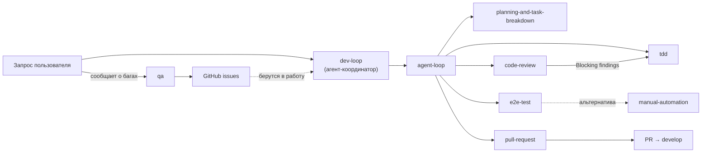

# DDC CRM — агенты и скиллы

Локальный набор агентских профилей и скиллов этого репозитория. Всё здесь относится только к DDC CRM:
пути, команды проверок и ветки (`develop`/`main`) — проектные.

`.claude/skills` — симлинк на `.agents/skills`, поэтому Claude Code и другие агенты видят один и тот
же набор.

## Как устроена папка скилла

| Файл | Для кого | Что внутри |
|---|---|---|
| `SKILL.md` | агент | Исполняемый контракт: frontmatter (`name`, `description`), шаги, критерии завершения. Загружается в контекст при вызове скилла. |
| `README.md` | человек | Обзор: зачем скилл, когда применять, граф workflow (mermaid), входы/выходы, связанные скиллы. В контекст агента не грузится. |
| `*.md` рядом | агент | Справочные материалы, на которые ссылается `SKILL.md` (например, `tdd/tests.md`). |

Правило синхронизации: при изменении шагов в `SKILL.md` обнови граф и разделы в соседнем
`README.md` в том же коммите. Источник истины — `SKILL.md`, а при конфликте — `AGENTS.md`.

## Каталог

| Скилл / агент | Назначение | README |
|---|---|---|
| `dev-loop` (агент) | Координатор: ведёт задачу от запроса до PR через скиллы ниже | [agents/README.md](agents/README.md) |
| `agent-loop` | Сквозной цикл: intake → план → TDD → проверки → ревью → QA → PR | [skills/agent-loop/README.md](skills/agent-loop/README.md) |
| `planning-and-task-breakdown` | Разбивка работы на вертикальные проверяемые задачи (`tasks/plan.md`, `tasks/todo.md`) | [README](skills/planning-and-task-breakdown/README.md) |
| `tdd` | Цикл red → green через публичные seams (Jest / Node test runner) | [README](skills/tdd/README.md) |
| `code-review` | Ревью диффа по двум осям: Standards и Spec | [README](skills/code-review/README.md) |
| `e2e-test` | Браузерная QA изменённых пользовательских сценариев SPA | [README](skills/e2e-test/README.md) |
| `manual-automation` | Ручная проверка живого UI под тестовой учёткой, воспроизведение визуальных багов | [README](skills/manual-automation/README.md) |
| `qa` | Интерактивная QA-сессия: баги от пользователя → GitHub issues | [README](skills/qa/README.md) |
| `pull-request` | Ветка, Conventional Commit, push, PR в `develop` | [README](skills/pull-request/README.md) |

## Карта взаимодействия

## Добавление нового скилла

1. Создай `.agents/skills/<name>/SKILL.md` с frontmatter `name` и `description` (описание — когда
   вызывать, именно по нему агент выбирает скилл).
2. Добавь `.agents/skills/<name>/README.md` по образцу соседних: заголовок, обзор, когда
   применять / не применять, граф workflow, входы и выходы, связанные скиллы.
3. Добавь строку в каталог и, если скилл встраивается в цикл, узел на карту выше.
4. Добавь скилл в список «Agents and Skills» и, при необходимости, в «Task Routing» в `AGENTS.md`.
