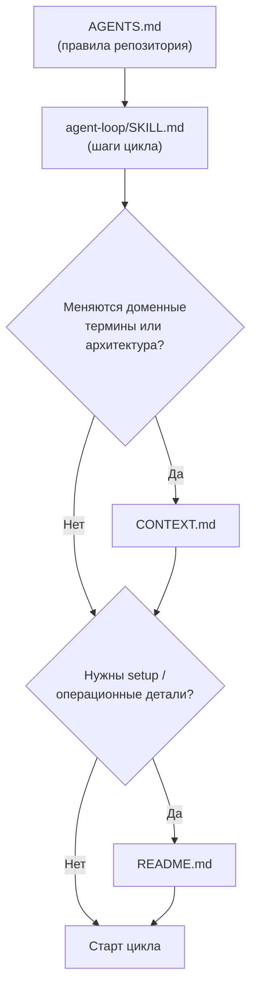
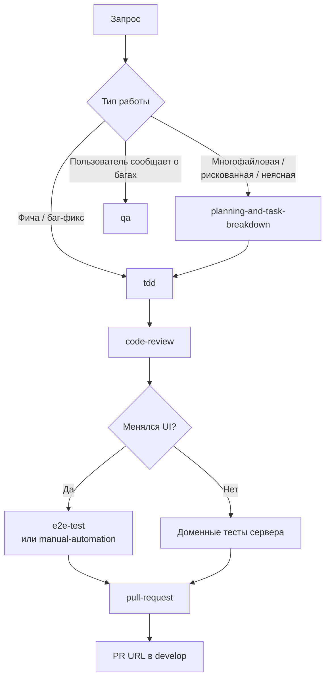

# Агенты (`.agents/agents`)

Профили агентов: роль, порядок загрузки контекста и маршрутизация по скиллам. Профиль не содержит
собственных шагов работы — он делегирует их скиллам из `.agents/skills/`.

## `dev-loop` — координатор доставки

Файл: [dev-loop.md](dev-loop.md). Ведёт задачу DDC CRM от запроса до готового PR в `develop`, держа
задачи маленькими и отдавая специализированную работу скиллам. Деплой в цикл не входит — его вручную
запускает владелец репозитория (`npm run deploy`).

### Когда применять

- Автономная работа над фичей или фиксом «от и до».
- Задача затрагивает несколько файлов или и `client/`, и `server/`.
- Нужно довести изменение до PR с пройденными проверками и ревью.

Не нужен для разовых вопросов, исследования кода или одиночной правки, где хватит прямого вызова
скилла.

### Порядок загрузки контекста

При конфликте профиль уступает `AGENTS.md`, `CONTEXT.md` и `agent-loop`.

### Маршрутизация по скиллам

### Критерий завершения

Работа реализована, релевантные проверки проходят (`npm run ci` из корня), в ревью нет блокирующих
находок, браузерная QA выполнена при изменении UI, и есть URL пулл-реквеста.

## Связанные файлы

- [../skills/agent-loop/README.md](../skills/agent-loop/README.md) — подробный граф цикла.
- [../README.md](../README.md) — каталог всех скиллов и карта взаимодействия.
