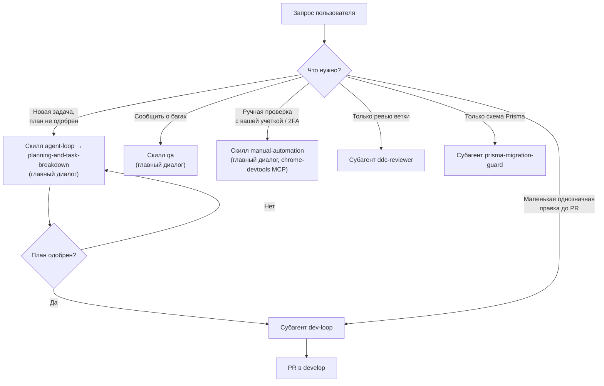
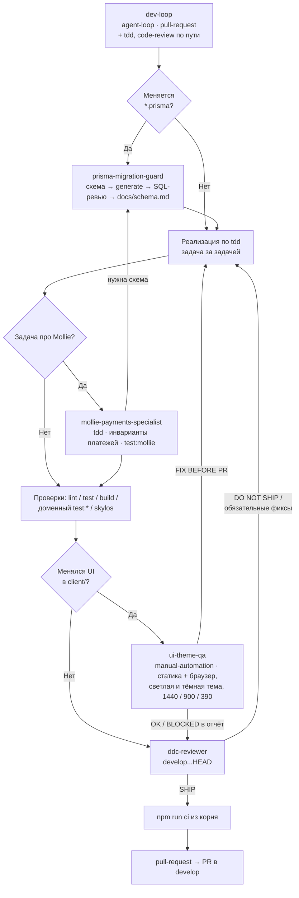

# Агенты (`.agents/agents`)

Субагенты Claude Code этого проекта. Claude Code видит их через симлинк
`.claude/agents → .agents/agents`. Файл с полями `name` и `description` во frontmatter — агент,
файл без `name` (как этот README) считается документацией и не загружается.

Агент решает, **кто** делает работу и **когда**. **Как** её делать, описывают скиллы из
`.agents/skills/`: агент подгружает их полем `skills:` (полный текст скилла попадает в контекст при
старте) или вызывает по ходу работы.

Важно: проектные `tdd` и `code-review` совпадают по имени с личными скиллами в
`~/.claude/skills/`, а личные важнее проектных. Поэтому их не предзагружают и не вызывают через
Skill — агенты читают `.agents/skills/tdd/SKILL.md` и `.agents/skills/code-review/SKILL.md` по
пути.

---

## Table of Contents

- [Каталог](#каталог)
- [Где запускать: главный диалог или субагент](#где-запускать-главный-диалог-или-субагент)
- [Карта делегирования](#карта-делегирования)
- [`dev-loop` — порядок цикла](#dev-loop--порядок-цикла)
- [Права и ограничения](#права-и-ограничения)
- [Добавление агента](#добавление-агента)

---

## Каталог

| Агент | Когда запускать | Подгружает скиллы | Правит файлы | Браузер |
|---|---|---|---|---|
| [`dev-loop`](dev-loop.md) | Одобренный план или маленькая однозначная задача — довести до PR | `agent-loop`, `pull-request` (+ `tdd`, `code-review` по пути) | Да | Через `ui-theme-qa` |
| [`prisma-migration-guard`](prisma-migration-guard.md) | Изменение `server/prisma/schema/*.prisma` или нужна миграция | — | Да (схема, миграция, `docs/schema.md`) | Нет |
| [`mollie-payments-specialist`](mollie-payments-specialist.md) | Вебхуки, клиенты, мандаты, подписки Mollie, платёжные ссылки инвойсов, данные `MolliePage` | `tdd` по пути | Да | Нет |
| [`ui-theme-qa`](ui-theme-qa.md) | Изменены UI или SCSS в `client/`, перед PR | `manual-automation` | Нет | Claude in Chrome, затем Chrome DevTools MCP |
| [`ddc-reviewer`](ddc-reviewer.md) | Шлюз перед PR, ревью ветки против `develop` | — (свой метод) | Нет | Нет |

---

## Где запускать: главный диалог или субагент

Субагент не может задать вопрос пользователю: при необходимости решения он останавливается и
возвращает вопрос. Поэтому всё, где нужен ответ, одобрение или учётка пользователя, остаётся в
главном диалоге.

---

## Карта делегирования

`dev-loop` выполняет предзагруженные скиллы сам и вызывает специалистов по триггерам из диффа.
Специалисты субагентов не запускают: нужна схема — возвращают задачу в `dev-loop`.

---

## `dev-loop` — порядок цикла

| # | Шаг | Кто | Условие |
|---|---|---|---|
| 1 | Ветка от `develop`, проверка чужих изменений | `dev-loop` | Всегда |
| 2 | Изменение схемы и миграция | `prisma-migration-guard` | Меняется `*.prisma` |
| 3 | Реализация test-first | `dev-loop` по `tdd`; Mollie — `mollie-payments-specialist` | Каждая задача плана |
| 4 | Проверки по изменённой поверхности | `dev-loop` | Всегда (таблица в `AGENTS.md`) |
| 5 | UI- и тема-QA | `ui-theme-qa` | Менялся UI в `client/` |
| 6 | Ревью-шлюз (до 3 кругов) | `ddc-reviewer`; без возможности запуска — `code-review` inline | Всегда |
| 7 | `npm run ci` | `dev-loop` | Перед push |
| 8 | PR в `develop` | `dev-loop` по `pull-request` | Вердикт SHIP |

Где `dev-loop` останавливается и возвращает вопрос: решение о данных или поведении продукта,
падение проверки вне задачи, BLOCKED или DO NOT SHIP, который не решить в рамках задачи, рост
диффа сверх плана.

---

## Права и ограничения

Без явного разрешения в промпте ни один агент не делает:

- `npm run e2e` (сбрасывает E2E-базу);
- применение миграций к dev-базе (`prisma-migration-guard` по умолчанию останавливается и
  возвращает команду);
- вход в приложение с учётными данными, которых нет в промпте;
- живые действия в Mollie, отправку email и Telegram;
- push в `main`, merge, релиз, деплой.

| Агент | `tools` | Особенности |
|---|---|---|
| `dev-loop` | Все унаследованные | Может запускать субагентов (Claude Code допускает вложенность до трёх уровней) |
| `prisma-migration-guard` | Read, Grep, Glob, Bash, Edit, Write | Без shadow DB: `migrate diff` + ручная миграция |
| `mollie-payments-specialist` | Read, Grep, Glob, Bash, Edit, Write | Без `Agent`: изменения схемы возвращает |
| `ui-theme-qa` | Read, Grep, Glob, Bash, `mcp__claude-in-chrome__*` (список), `mcp__chrome-devtools__*` | Edit/Write запрещены; формы не отправляет |
| `ddc-reviewer` | Read, Grep, Glob, Bash | Edit/Write запрещены; e2e, миграции, деплой не запускает |

---

## Добавление агента

1. Создай `.agents/agents/<name>.md` с frontmatter Claude Code: `name`, `description` (когда
   делегировать — по нему главный агент выбирает исполнителя), `tools` / `disallowedTools`,
   `model`; при необходимости `skills:` для предзагрузки скиллов и `mcpServers:` для MCP.
2. Добавь строку в [каталог](#каталог), узел на подходящую карту и, если агент встраивается в цикл,
   триггер в таблицу маршрутизации `dev-loop.md` и в «What to Run When» в `AGENTS.md`.
3. Скиллы, которые агент предзагружает, должны существовать в `.agents/skills/` — отсутствующий
   скилл пропускается с предупреждением только в debug-логе.
