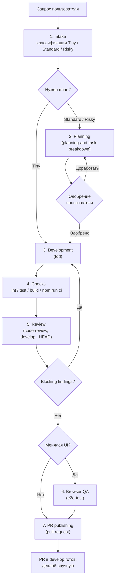

# Сквозной цикл доставки (`agent-loop`)

Координирует работу над DDC CRM от запроса до пулл-реквеста: intake, планирование, TDD, проверки,
ревью, браузерная QA и публикация PR. Покрывает React 19 SPA (`client/`) и Express 5 + Prisma API
(`server/`).

## Обзор

Координатор отвечает за оркестрацию, статус, ревью и публикацию. Правки кода на этапе разработки по
возможности отдаются сабагенту; если сабагентов нет, тот же цикл выполняется напрямую маленькими
шагами. Каждый этап заканчивается явным критерием завершения, без него переход дальше не делается.

Деплой намеренно вне цикла: GitHub Actions только гоняет CI, `npm run deploy` запускает владелец.

## Когда применять

- Автономная реализация фичи или баг-фикса до готового PR.
- «Dev loop», «доведи до PR», сквозная доставка перед релизом.

Не применять для чистого исследования кода, ответа на вопрос или QA-сессии с заведением issues
(для неё есть `qa`).

## Workflow



### Этапы

| # | Этап | Результат (критерий завершения) |
|---|---|---|
| 1 | Intake | Известны объём, риски и нужные скиллы; определено, клиент/сервер/оба |
| 2 | Planning | `tasks/plan.md` и `tasks/todo.md`, задачи маленькие и одобрены |
| 3 | Development | Задача реализована test-first и отмечена в `tasks/todo.md` |
| 4 | Checks | Проверки по изменённой поверхности проходят, иначе блокер задокументирован |
| 5 | Review | Нет блокирующих находок по Standards и Spec |
| 6 | Browser QA | Изменённые сценарии рендерятся без сломанной вёрстки и ошибок консоли |
| 7 | PR publishing | URL PR возвращён пользователю |

Классификация на intake: **Tiny** — очевидная правка одного файла; **Standard** — фича или фикс на
несколько файлов; **Risky** — auth/security, инвойсы, Mollie, email, организации/бренды, схема
Prisma, релиз, широкие стилевые правки.

## Входы и выходы

- **Читает:** `AGENTS.md`, `CONTEXT.md`, `README.md`, локальный roadmap из `docs/roadmap/` (gitignored)
  для затронутой области.
- **Создаёт:** `tasks/plan.md`, `tasks/todo.md` (для Standard/Risky), ветку `feat/*` / `fix/*`, PR.

## Зависимости

- `git`, `gh` (аутентифицирован) — для этапа публикации.
- Node.js и установленные зависимости `client/` и `server/` — для проверок.
- Запущенный dev SPA на `:3000` — для браузерной QA.

## Пример вызова

```text
/agent-loop Добавь фильтр по филиалу в список студентов
```

## Структура и связанные скиллы

```
agent-loop/
├── README.md   # обзор и граф (этот файл)
└── SKILL.md    # исполняемый контракт для агента
```

- Planning → [planning-and-task-breakdown](../planning-and-task-breakdown/README.md)
- Development → [tdd](../tdd/README.md)
- Review → [code-review](../code-review/README.md)
- Browser QA → [e2e-test](../e2e-test/README.md) / [manual-automation](../manual-automation/README.md)
- Publishing → [pull-request](../pull-request/README.md)
- Координатор → [dev-loop](../../agents/README.md)
