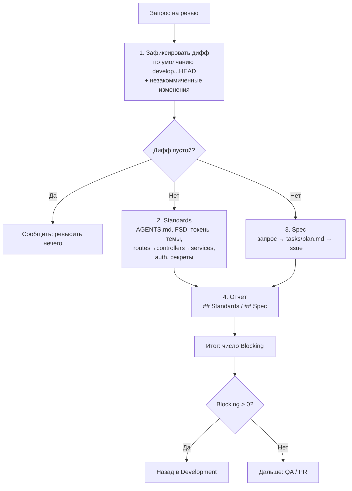

# Ревью кода (`code-review`)

Проверяет дифф DDC CRM по двум осям: **Standards** (соответствие правилам репозитория) и **Spec**
(соответствие запросу, issue или `tasks/plan.md`). Итог — отчёт с находками по уровням серьёзности
и числом блокирующих.

## Обзор

Ревью сфокусировано на багах, регрессиях, пропущенных проверках, ошибках безопасности и приватности
и расхождениях со спецификацией. Замечания только по стилю — кратко, если они не нарушают
задокументированное правило. Каждая находка привязана к `file:line` и содержит предложение по
исправлению.

## Когда применять

- Перед публикацией PR (этап 5 в `agent-loop`).
- Ревью незакоммиченных изменений.
- Ревью «начиная с» ветки, коммита или тега.

## Workflow



## Уровни серьёзности

| Уровень | Значение |
|---|---|
| `Blocking` | Исправить до PR |
| `Non-blocking` | Стоит исправить, но PR может идти |
| `Question` | Нужно уточнение от продукта или пользователя |

## Постоянные проверки Standards

- FSD-импорты только через публичный API слайса (`@/slice`), без глубоких импортов.
- Функциональные компоненты с `memo()`, текст через i18next, SCSS Modules и токены темы, тёмная тема.
- Сервер: `routes → controllers → services`, Zod в `schemas/`.
- Auth не ослаблен: cookie-сессии, CSRF, Argon2id, rate limiting.
- После изменения Prisma — `prisma:generate` и миграция.
- Нет секретов, `.env`, uploads, `.DS_Store`, `node_modules/` и AI-трейлеров в коммитах.
- Архитектурный quality gate (`.claude/rules/architecture-quality-gate.md`) для исполняемого кода.

## Структура и связанные скиллы

```
code-review/
├── README.md   # обзор и граф (этот файл)
└── SKILL.md    # шаги, постоянные проверки, формат отчёта
```

- Вызывается из [agent-loop](../agent-loop/README.md) на этапе 5.
- Ось Spec берёт критерии приёмки из [planning-and-task-breakdown](../planning-and-task-breakdown/README.md).
- Находки возвращаются в [tdd](../tdd/README.md); при чистом ревью — дальше в [pull-request](../pull-request/README.md).
