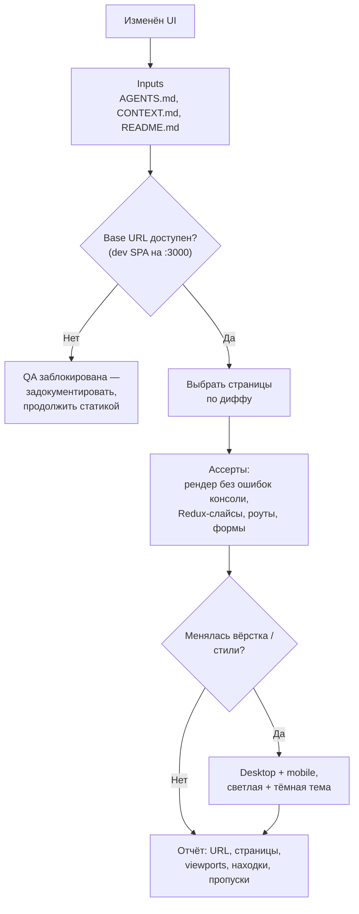

# Браузерная QA (`e2e-test`)

Проверяет пользовательское поведение React 19 admin SPA после изменений в клиенте: страницы, формы,
навигацию, стили. Дополняет статические проверки, но не заменяет их.

## Обзор

Предпочтение — уже запущенное приложение, без перезапуска сервисов. Сначала проверяются сценарии,
затронутые диффом. Для точных проверок используются DOM- и state-ассерты, для вёрстки — скриншоты.
Реальные данные клиентов в формы не отправляются.

## Когда применять

- Изменены компоненты, формы, клиентский JS, SCSS, навигация или страницы.
- Этап 6 `agent-loop` при изменении UI.

Для воспроизведения конкретного визуального бага или разовой ручной проверки удобнее
[manual-automation](../manual-automation/README.md). Автоматизированные Playwright-спеки — отдельная
инфраструктура, см. `docs/E2E_TESTING.md`.

## Workflow



## Какие сценарии проверять

| Что менялось | Сценарий |
|---|---|
| Auth | Логин и сессия |
| Клиенты / студенты / группы | Соответствующий доменный сценарий |
| Расписание | Календарь / расписание |
| Инвойсы, Mollie | Инвойсы и платежи |
| Email | Почтовые аккаунты и сообщения |
| Любая страница или фича | Изменённая страница в `client/src/pages/` или `client/src/features/` |

## Безопасность

- Только тестовые данные; живая отправка — лишь с явного согласия пользователя.
- Не править `.env` и базу, чтобы QA прошла.

## Структура и связанные скиллы

```
e2e-test/
├── README.md   # обзор и граф (этот файл)
└── SKILL.md    # шаги, ассерты, формат отчёта
```

- Вызывается из [agent-loop](../agent-loop/README.md) на этапе 6.
- Альтернатива для ручной проверки — [manual-automation](../manual-automation/README.md).
- После QA — [pull-request](../pull-request/README.md).
