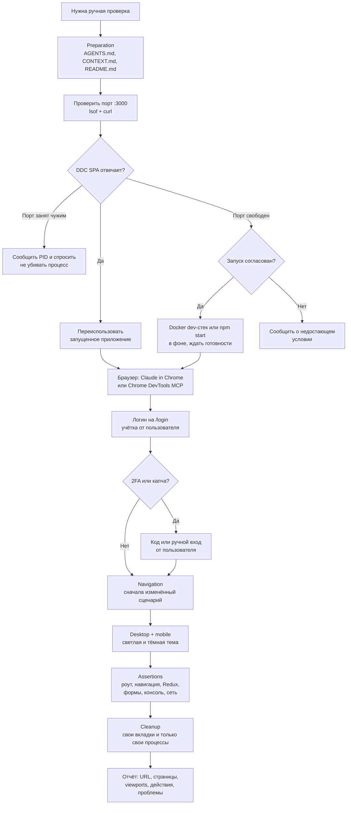

# Ручная браузерная автоматизация (`manual-automation`)

Ручные проверки живого UI DDC CRM через браузер: поиск или безопасный запуск dev-приложения, вход
под тестовой учёткой, осмотр страниц, воспроизведение визуальных и интерактивных багов, проверка
форм без автотестового покрытия.

## Обзор

Скилл намеренно консервативный: в первую очередь переиспользует уже запущенное приложение (часто это
Docker dev-стек пользователя на `:3000`), никогда не останавливает чужие процессы и контейнеры без
согласия, не правит базу и `.env`, не раскрывает секреты. Запускает приложение сам только когда
ничего не запущено и это согласовано — и тогда же сам его останавливает в конце. Открытые для
проверки вкладки закрываются, вкладки и сервисы пользователя не трогаются.

Структура этапов (порты → запуск → браузер → логин → проверки → уборка) взята из upstream-скилла
[larchanka/skills `manual-automation`](https://github.com/larchanka/skills/tree/main/manual-automation)
и адаптирована под DDC CRM: реальные порты и команды, cookie-сессия с CSRF, 2FA и Turnstile,
браузерные инструменты этого окружения.

## Когда применять

- Нужно посмотреть на живой UI или воспроизвести визуальный баг.
- Пройти вручную по странице под логином, проверить навигацию или валидацию формы без автотестов.

Не применять для штатной QA изменённых сценариев в рамках цикла доставки и для Playwright-набора —
это [e2e-test](../e2e-test/README.md) и [docs/E2E_TESTING.md](../../../docs/E2E_TESTING.md).

## Workflow



## Безопасность

- Не отправлять реальные данные клиентов, не выполнять разрушительные действия без запроса.
- Не придумывать и не хардкодить учётные данные; не выводить пароли, коды 2FA, cookies.
- Не раскрывать креды БД, значения `.env`, приватные URL.
- Не перезапускать сервисы, не останавливать чужие процессы и контейнеры, не править базу без явного
  согласия.

## Зависимости

- Браузерный инструмент: Claude in Chrome (`mcp__claude-in-chrome__*`, скилл `browser-automation`)
  или настроенный Chrome DevTools MCP. Без него ручная проверка блокируется.
- `lsof` и `curl` для проверки порта и доступности (есть в macOS по умолчанию).

## Структура и связанные скиллы

```
manual-automation/
├── README.md   # обзор и граф (этот файл)
└── SKILL.md    # шаги, логин, инструменты, ассерты, правила безопасности
```

- Альтернатива [e2e-test](../e2e-test/README.md) в [agent-loop](../agent-loop/README.md).
- Найденные баги можно завести через [qa](../qa/README.md).
