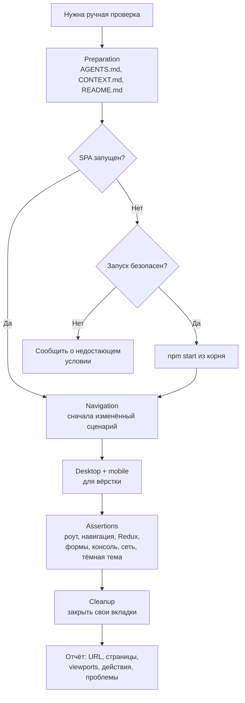

# Ручная браузерная автоматизация (`manual-automation`)

Ручные проверки живого UI DDC CRM через браузер: осмотр запущенного клиента, воспроизведение
визуальных и интерактивных багов, проверка форм без автотестового покрытия.

## Обзор

Скилл намеренно консервативный: работает с уже запущенным приложением, не перезапускает сервисы и
не правит базу без явного разрешения, не раскрывает секреты. Открытые для проверки вкладки
закрываются в конце, вкладки и сервисы пользователя не трогаются.

## Когда применять

- Нужно посмотреть на живой UI или воспроизвести визуальный баг.
- Проверить навигацию или валидацию формы, у которой нет автотестов.

Для штатной QA изменённых сценариев в рамках цикла доставки — [e2e-test](../e2e-test/README.md).

## Workflow



## Безопасность

- Не отправлять реальные данные клиентов.
- Не раскрывать креды БД, значения `.env`, приватные URL.
- Не перезапускать сервисы и не править базу без явного согласия.

## Структура и связанные скиллы

```
manual-automation/
├── README.md   # обзор и граф (этот файл)
└── SKILL.md    # шаги, ассерты, правила безопасности
```

- Альтернатива [e2e-test](../e2e-test/README.md) в [agent-loop](../agent-loop/README.md).
- Найденные баги можно завести через [qa](../qa/README.md).
