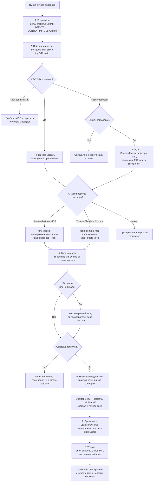

# Ручная браузерная автоматизация (`manual-automation`)

Ручные проверки живого UI DDC CRM в настоящем браузере через Chrome DevTools MCP: найти или
безопасно запустить dev-приложение, войти под тестовой учёткой, пройти по страницам, проверить
светлую и тёмную темы и ширины экрана, собрать ошибки консоли и сети, воспроизвести визуальный или
интерактивный баг, проверить форму без автотестов.

---

## Table of Contents

- [Обзор и принципы](#обзор-и-принципы)
- [Когда применять](#когда-применять)
  - [Подходящие сценарии](#подходящие-сценарии)
  - [Когда не применять](#когда-не-применять)
- [Жёсткие правила](#жёсткие-правила)
- [Workflow](#workflow)
  - [Этапы](#этапы)
- [Зависимости и подключение MCP](#зависимости-и-подключение-mcp)
  - [Что нужно](#что-нужно)
  - [Конфигурация `.mcp.json`](#конфигурация-mcpjson)
  - [Включение и проверка](#включение-и-проверка)
- [Использование и примеры](#использование-и-примеры)
  - [Вызов](#вызов)
  - [Справочник MCP-инструментов](#справочник-mcp-инструментов)
  - [Пример: вход и проверка страницы](#пример-вход-и-проверка-страницы)
  - [Ширины экрана и темы](#ширины-экрана-и-темы)
- [Обработка ошибок и пограничные случаи](#обработка-ошибок-и-пограничные-случаи)
- [Критерии завершения](#критерии-завершения)
- [Структура и связанные скиллы](#структура-и-связанные-скиллы)

---

## Обзор и принципы

Статические проверки и юнит-тесты не видят того, что происходит в рантайме SPA: асинхронной
загрузки данных, клиентского роутинга, гидрации Redux-слайсов, cookie-сессии с CSRF, переключения
темы. Этот скилл даёт агенту настоящий браузер и правила, по которым им пользоваться.

Принципы:

1. **Переиспользование вместо перезапуска.** Пользователь часто держит Docker dev-стек на `:3000`.
   Скилл сначала ищет запущенное приложение и запускает своё только по согласованию.
2. **Неприкосновенность чужого окружения.** Чужие процессы и контейнеры не останавливаются, `.env`
   и база не правятся, браузер DevTools MCP работает в изолированном временном профиле.
3. **Доказательства, а не предположения.** Ответ `200` — ещё не успех. Каждый вывод подкреплён
   снапшотом, скриншотом, консолью или сетевым запросом.
4. **Ожидание состояния вместо таймаутов.** `wait_for` и опрос готовности, никаких фиксированных
   `sleep`.
5. **Уборка только за собой.** Закрываются свои страницы, останавливается только свой PID,
   восстанавливается изменённое состояние браузера.

Структура этапов взята из upstream-скилла
[larchanka/skills `manual-automation`](https://github.com/larchanka/skills/tree/main/manual-automation)
и адаптирована под DDC CRM: реальные порты и команды, вход с 2FA и Turnstile, реальный пакет MCP
и его модель взаимодействия через `uid`.

---

## Когда применять

### Подходящие сценарии

- **Воспроизведение бага:** пользователь сообщил о визуальной или интерактивной проблеме на
  конкретной странице.
- **Ручной проход после правки UI:** страница или сценарий под залогиненной тестовой учёткой.
- **Темы и адаптив:** светлая и тёмная тема, desktop / tablet / mobile, сворачивание сайдбара.
- **Формы и модалки без покрытия:** валидация, диалоги, загрузка файлов.
- **Клиентская диагностика:** ошибки консоли, упавшие запросы к API (`401` сессии, `403` CSRF,
  `422`, `5xx`).
- **Аудит доступности:** Lighthouse (accessibility / best practices) по запросу.

### Когда не применять

- **QA изменённых сценариев в цикле доставки и Playwright-набор** — это
  [e2e-test](../e2e-test/README.md) и [docs/E2E_TESTING.md](../../../docs/E2E_TESTING.md).
- **Логика сервисов, слайсов и компонентов** — [tdd](../tdd/README.md): Jest на клиенте и доменные
  тестовые скрипты на сервере.
- **Чистый контракт API без UI** — `curl` к `/api/v1/...` или серверные тесты.
- **Продакшен или реальный аккаунт клиента** — только по явной просьбе пользователя и с указанной
  им целью.

---

## Жёсткие правила

1. Сначала переиспользовать запущенное приложение. Своё запускать только по согласованию.
2. Не убивать то, что запустил не агент: никаких `kill`, `docker stop/restart/down` и захвата порта.
   На другой порт самовольно не переходить.
3. Учётные данные — только от пользователя. Их нельзя придумывать, подбирать, читать из `.env`, базы
   или почтовых логов и выводить в отчёт; это касается и кодов 2FA.
4. Только тестовые данные. Никаких удалений, отправки писем и инвойсов, операций Mollie и сообщений
   в Telegram без прямой просьбы.
5. Не менять окружение ради прохождения проверки: без правок `.env`, миграций, сидов и правок базы.
6. Вывод подтверждается видимым состоянием UI, снапшотом, консолью и сетью.
7. Ждать состояние, а не время.
8. Убирать только за собой.

---

## Workflow



### Этапы

| # | Этап | Что происходит | Критерий завершения |
|---|---|---|---|
| 1 | Preparation | Цель, страницы, роли, ширины и темы; что спросить у пользователя | Цель и окружение ясны |
| 2 | Найти приложение | Проверить порты SPA и API, Docker-стек | Есть рабочий base URL или сообщено о конфликте |
| 3 | Запуск | Только если ничего не запущено и запуск согласован; PID записан | Приложение отвечает или есть отчёт о сбое |
| 4 | Браузер | DevTools MCP → Claude in Chrome → headless → блокер | Агент управляет своей страницей |
| 5 | Вход | `fill_form` по `uid`, 2FA и капча через пользователя | Сессия подтверждена сайдбаром или есть причина отказа |
| 6 | Навигация | Сценарий, формы, диалоги, матрица ширин и тем | Все целевые страницы пройдены |
| 7 | Проверки | Роут, данные, валидация, консоль, сеть, тёмная тема | У каждой проверки есть результат и доказательство |
| 8 | Уборка | Свои страницы, свой процесс, восстановление состояния | Окружение пользователя в исходном виде |

---

## Зависимости и подключение MCP

### Что нужно

| Зависимость | Зачем | Версия |
|---|---|---|
| Google Chrome (stable) | Браузер, которым управляет MCP-сервер | Текущий stable |
| Node.js + npm | Запуск MCP-сервера через `npx` | Node `^20.19.0 \|\| ^22.12.0 \|\| >=23` |
| [`chrome-devtools-mcp`](https://github.com/ChromeDevTools/chrome-devtools-mcp) | MCP-сервер Chrome DevTools | `1.10.1`, закреплён в `.mcp.json` |
| `lsof`, `curl` | Проверка портов и доступности | Есть в macOS |
| Claude in Chrome (опционально) | Запасной вариант: реальный Chrome пользователя | Расширение Claude |

Upstream-README ссылается на пакет `@modelcontextprotocol/server-chrome-devtools` — его нет в npm.
Настоящий сервер — `chrome-devtools-mcp` от команды Chrome DevTools.

### Конфигурация `.mcp.json`

Сервер подключён на уровне проекта, в корневом `.mcp.json`:

```json
"chrome-devtools": {
    "command": "npx",
    "args": [
        "-y",
        "chrome-devtools-mcp@1.10.1",
        "--isolated",
        "--viewport=1440x900",
        "--no-usage-statistics",
        "--no-performance-crux"
    ],
    "env": { "CHROME_DEVTOOLS_MCP_NO_UPDATE_CHECKS": "1" }
}
```

| Параметр | Зачем |
|---|---|
| `@1.10.1` | Точная версия вместо `@latest`: обновление — осознанный шаг через PR |
| `--isolated` | Временный профиль Chrome, удаляется после закрытия; cookies и вкладки пользователя не затрагиваются |
| `--viewport=1440x900` | Стартовая ширина — desktop-строка матрицы проверок |
| `--no-usage-statistics` | Не отправлять статистику использования в Google |
| `--no-performance-crux` | Не отправлять URL трейсов в CrUX API — локальные адреса CRM не уходят наружу |
| `CHROME_DEVTOOLS_MCP_NO_UPDATE_CHECKS` | Без периодических запросов к npm за обновлениями |

По умолчанию браузер запускается с интерфейсом (headed), чтобы за проверкой можно было следить.
Для фонового прогона добавь `--headless`.

### Включение и проверка

1. Серверы из `.mcp.json` включаются по одному. Локально `chrome-devtools` уже добавлен в
   `enabledMcpjsonServers` в `.claude/settings.local.json` (файл в gitignore). На другой машине
   Claude Code спросит подтверждение при первом запуске.
2. Перезапусти сессию Claude Code: новые MCP-серверы подхватываются только при старте.
3. Проверь командой `/mcp`: `chrome-devtools` должен быть в статусе connected, а инструменты
   `mcp__chrome-devtools__*` — доступны.
4. Chrome запускается не при подключении сервера, а при первом вызове инструмента, которому нужен
   браузер (например, `new_page`).

---

## Использование и примеры

### Вызов

```text
/manual-automation Проверь страницу «Студенты» в тёмной теме на мобильной ширине — пользователь говорит, что фильтр по филиалу не виден
```

```text
/manual-automation Воспроизведи: после сохранения инвойса модалка остаётся светлой в тёмной теме
```

Учётку для входа агент спросит сам и в отчёт её не запишет.

### Справочник MCP-инструментов

Инструменты, привязанные к странице, принимают `pageId`. Инструменты для элементов принимают `uid`
из последнего `take_snapshot` — CSS-селекторы этот сервер не использует.

| Категория | Инструменты | Для чего здесь |
|---|---|---|
| Навигация | `new_page`, `navigate_page`, `select_page`, `list_pages`, `close_page`, `wait_for` | Своя страница, переходы, ожидание видимого текста |
| Ввод | `click`, `fill`, `fill_form`, `type_text`, `press_key`, `hover`, `drag`, `upload_file`, `handle_dialog` | Вход, формы, сайдбар, диалоги |
| Эмуляция | `emulate` (`viewport`, `networkConditions`, `cpuThrottlingRate`), `resize_page` | Мобильная и планшетная ширина, медленная сеть |
| Сеть | `list_network_requests`, `get_network_request` | Упавшие запросы, ошибки сессии и CSRF |
| Отладка | `take_snapshot`, `take_screenshot`, `evaluate_script`, `list_console_messages`, `get_console_message`, `get_css_styles`, `lighthouse_audit` | Доказательства, переключение темы, вычисленные стили, a11y |
| Производительность | `performance_start_trace`, `performance_stop_trace`, `performance_analyze_insight` | Только если вопрос про производительность |

Полные параметры —
[tool reference v1.10.1](https://github.com/ChromeDevTools/chrome-devtools-mcp/blob/chrome-devtools-mcp-v1.10.1/docs/tool-reference.md).

### Пример: вход и проверка страницы

**Шаг 1 — найти приложение (терминал).**

```bash
lsof -nP -iTCP:3000 -sTCP:LISTEN          # кто слушает порт SPA
curl -sI http://localhost:3000            # SPA отвечает?
curl -s http://localhost:18080/api/v1/health   # API (Docker dev-стек)
```

SPA отвечает — переиспользуем, ничего не запускаем и не останавливаем.

**Шаг 2 — открыть страницу входа и получить `uid`.**

```json
{ "tool": "new_page", "arguments": { "url": "http://localhost:3000/login" } }
{ "tool": "wait_for", "arguments": { "pageId": 1, "text": ["Пароль"] } }
{ "tool": "take_snapshot", "arguments": { "pageId": 1 } }
```

В снапшоте поля выглядят примерно так: `uid=4_12 textbox "Электронная почта"`,
`uid=4_13 textbox "Пароль"`, `uid=4_14 button "Войти"`.

**Шаг 3 — войти одной операцией.**

```json
{ "tool": "fill_form", "arguments": { "pageId": 1, "elements": [
    { "uid": "4_12", "value": "<email от пользователя>" },
    { "uid": "4_13", "value": "<пароль от пользователя>" }
] } }
{ "tool": "click", "arguments": { "pageId": 1, "uid": "4_14" } }
{ "tool": "wait_for", "arguments": { "pageId": 1, "text": ["Студенты", "Введите код подтверждения", "Вы ввели неверный логин или пароль"] } }
```

Если появился шаг с кодом 2FA, агент спрашивает код у пользователя. Если вход не прошёл, агент
делает одну попытку и сообщает сообщение UI (дальше включится Turnstile).

**Шаг 4 — проверить страницу и собрать доказательства.**

```json
{ "tool": "navigate_page", "arguments": { "pageId": 1, "type": "url", "url": "http://localhost:3000/students" } }
{ "tool": "wait_for", "arguments": { "pageId": 1, "text": ["Студенты"] } }
{ "tool": "take_snapshot", "arguments": { "pageId": 1 } }
{ "tool": "list_console_messages", "arguments": { "pageId": 1, "types": ["error"] } }
{ "tool": "list_network_requests", "arguments": { "pageId": 1, "resourceTypes": ["fetch", "xhr"] } }
```

Маршрут `/students` и подписи формы входа взяты из кода (`shared/config/routeConfig`,
`features/Auth/ui/LoginForm`). `pageId` и `uid` в примере условные: реальные значения возвращают
`new_page` и `take_snapshot`.

### Ширины экрана и темы

| Ширина | Вызов | Ожидание |
|---|---|---|
| Desktop | `resize_page` `1440 × 900` | Полный сайдбар 288px + контент |
| Tablet | `resize_page` `900 × 1100` | Сайдбар сворачивается сам (769–1024px) |
| Mobile | `emulate` `viewport: "390x844x3,mobile,touch"` | Сайдбар — оверлей (≤ 768px), контент на всю ширину |

Тема приложения не зависит от `prefers-color-scheme`, поэтому `emulate colorScheme` её **не**
переключит. Тема — это класс `body` (`app_light_theme` / `app_dark_theme`), который хранится в
`localStorage` под ключом `theme`. Варианты:

- нажать переключатель темы в навбаре — как пользователь;
- или выполнить `evaluate_script`:

  ```js
  () => { localStorage.setItem('theme', 'app_dark_theme'); location.reload(); }
  ```

  После проверки вернуть прежнее значение.

На что смотреть в тёмной теме: модалки, которые остались светлыми (legacy `--white` у `Modal`),
читаемость текста, видимость рамок. Подробнее — `DESIGN.md`, раздел Theming.

---

## Обработка ошибок и пограничные случаи

| Ситуация | Что делать |
|---|---|
| Порт `3000` занят чужим процессом | Сообщить PID и команду, спросить. Не убивать, не переходить на другой порт самовольно |
| Приложение не стало готовым | Прекратить опрос по таймауту, показать последние строки лога; не трогать `.env` и миграции |
| Нет инструментов `chrome-devtools` | Сервер не подключён: нужен перезапуск Claude Code, Node ≥ 20.19, установленный Chrome. Перейти на Claude in Chrome и сообщить об этом |
| Chrome не стартует в MCP | Сообщить ошибку, предложить поставить Chrome stable; не подставлять наугад `--executablePath` |
| `wait_for` по таймауту | `take_snapshot` + `take_screenshot` + `list_console_messages`: элемент может закрывать модалка, ошибка, лоадер или редирект на вход |
| `uid` не найден или устарел | Новый `take_snapshot` и повторный поиск; не переходить на угаданные селекторы |
| Вход не удался | Сообщение UI и статус запроса входа; одна попытка из-за Turnstile |
| Шаг с кодом 2FA | Спросить код у пользователя; не читать его из базы или почты |
| `401` после входа | Cookie сессии не установилась — проверить адрес API и CORS в сети; сообщить, конфиг не править |
| `403` на изменяющих запросах | Истёк CSRF-токен — перезагрузить страницу (заново `/auth/csrf`), одна повторная попытка, затем отчёт |
| Нативный диалог блокирует страницу | `handle_dialog` с `dismiss`, если пользователь не просил подтвердить действие |

---

## Критерии завершения

- Использован рабочий base URL; записано, переиспользовано приложение или запущено агентом.
- Ни один чужой процесс не остановлен; свой процесс остановлен, порт свободен.
- Браузер подключён, все целевые страницы и сценарии пройдены.
- Вход выполнен или сообщена причина отказа (учётка, 2FA, капча, Telegram).
- Проверены нужные ширины и темы.
- У каждой проверки есть результат и доказательство: снапшот, скриншот, консоль или сеть.
- Свои страницы закрыты, изменённое состояние браузера восстановлено.

Формат отчёта: base URL и страницы, инструмент, ширины и темы, выполненные действия (без учёток и
кодов), находки с доказательствами, блокеры и пропущенные проверки с причинами.

---

## Структура и связанные скиллы

```
manual-automation/
├── README.md   # обзор, граф, подключение MCP, примеры (этот файл)
└── SKILL.md    # исполняемый контракт: правила, 8 шагов, ошибки, критерии, справочник инструментов
```

Конфигурация MCP-сервера — корневой `.mcp.json` (сервер `chrome-devtools`).

- Альтернатива [e2e-test](../e2e-test/README.md) в [agent-loop](../agent-loop/README.md).
- Найденные баги можно завести через [qa](../qa/README.md).
- Визуальные эталоны тем и брейкпоинтов — `DESIGN.md` в корне (после мержа PR #187).
