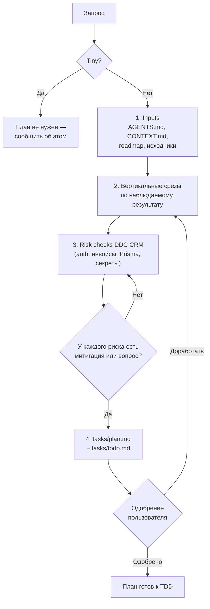

# Планирование и разбивка задач (`planning-and-task-breakdown`)

Превращает запрос в упорядоченный список маленьких проверяемых задач с критериями приёмки, командами
проверки и рисками DDC CRM. Результат — `tasks/plan.md` и `tasks/todo.md`.

## Обзор

Планирование идёт вертикальными срезами: после каждой задачи приложение компилируется и проверки
проходят. Срез строится вокруг наблюдаемого результата — страница рендерится, эндпоинт валидирует и
сохраняет, миграция применена и клиент работает, форма проходит через API.

## Когда применять

- Многофайловые фичи, изменения сразу в `client/` и `server/`.
- Рискованные области: auth/security, инвойсы и Mollie, организации/бренды, схема Prisma.
- Неясные требования или работа под координацией `agent-loop`.

Не применять для Tiny-правок: тогда план не пишется, и это явно указывается.

## Workflow



## Формат задачи

Каждая задача содержит: описание, критерии приёмки (чек-лист наблюдаемого поведения), проверку
(client lint/Jest, server build + доменный тест, Prisma generate + миграция, браузерная QA, скан
секретов), зависимости, вероятно затрагиваемые файлы и оценку `XS | S | M`. Шаблоны `plan.md` и
`todo.md` — в [SKILL.md](SKILL.md).

## Входы и выходы

- **Читает:** `AGENTS.md`, `CONTEXT.md`, `README.md`, локальный `docs/roadmap/` (gitignored), код
  затронутых слайсов, роутов, сервисов и `server/prisma/schema/*.prisma`.
- **Создаёт:** `tasks/plan.md`, `tasks/todo.md`.

## Пример вызова

```text
/planning-and-task-breakdown Перенос напоминаний об оплате на шаблоны из настроек
```

## Структура и связанные скиллы

```
planning-and-task-breakdown/
├── README.md   # обзор и граф (этот файл)
└── SKILL.md    # правила, формат задачи, шаблоны plan/todo
```

- Вызывается из [agent-loop](../agent-loop/README.md) на этапе 2.
- Задачи реализуются через [tdd](../tdd/README.md).
- Критерии приёмки становятся осью Spec в [code-review](../code-review/README.md).
