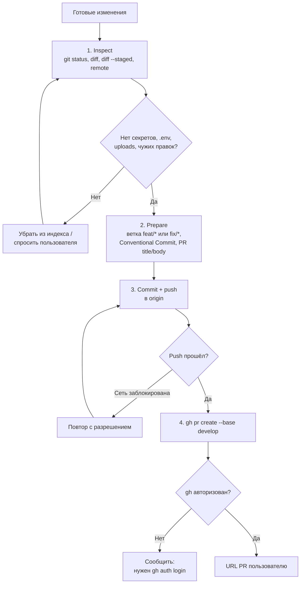

# Публикация пулл-реквеста (`pull-request`)

Упаковывает локальные изменения DDC CRM в пулл-реквест в `develop`: проверка диффа, ветка
`feat/*` / `fix/*`, Conventional Commit, push и `gh pr create`. Скилл заканчивается созданием PR —
релиз в `main` и деплой остаются за владельцем репозитория.

## Обзор

- Перед любыми изменениями ветки проверяется состояние репозитория.
- Индексируются только нужные файлы, без чужих изменений и секретов.
- Сообщение коммита оформляется по [commit-message-instructions.md](commit-message-instructions.md).
- AI-трейлеры (`Co-authored-by`, `Generated-by` и т. п.) не добавляются без явной просьбы.

## Когда применять

- Работа готова и проверки прошли — нужно опубликовать её на ревью.
- Этап 7 `agent-loop`.

## Workflow



## Тело PR

- Пользовательские изменения.
- Выполненные проверки (`npm run ci`, клиентские/серверные, доменные тесты) и браузерная QA.
- Пропущенные проверки и отложенный релиз/деплой.
- Ссылки на issues.

## Зависимости

- `git`, `gh` (аутентифицирован), `origin` → `https://github.com/Myrhoiazov/ddc-nl-crm.git`.
- Проверки из `AGENTS.md` пройдены или блокеры задокументированы.

## Структура и связанные скиллы

```
pull-request/
├── README.md                        # обзор и граф (этот файл)
├── SKILL.md                         # шаги публикации
└── commit-message-instructions.md   # формат сообщения коммита
```

- Финальный этап [agent-loop](../agent-loop/README.md).
- Входит после [code-review](../code-review/README.md) и, при изменении UI, [e2e-test](../e2e-test/README.md).
