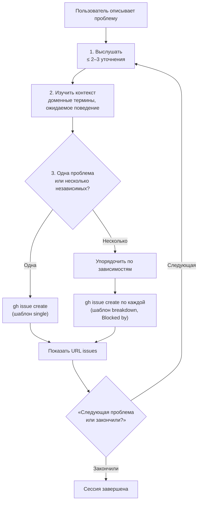

# QA-сессия (`qa`)

Интерактивная сессия: пользователь описывает проблемы своими словами, агент слегка уточняет, изучает
контекст и заводит durable GitHub issues на языке домена из `CONTEXT.md`.

## Обзор

Цель — не исправить баг, а хорошо его описать. Issue пишется с точки зрения пользователя и остаётся
понятным после рефакторинга: без путей к файлам и номеров строк, с поведением вместо кода и
обязательными шагами воспроизведения. Уточняющих вопросов — не больше 2–3.

## Когда применять

- Пользователь хочет сообщить о багах, провести QA или завести issues.

Не применять для исправления багов — это работа для [agent-loop](../agent-loop/README.md) или
[tdd](../tdd/README.md).

## Workflow



## Правила тела issue

- Без путей к файлам и номеров строк.
- Термины домена из `CONTEXT.md` (клиент, студент, группа, расписание, инвойс, платёж Mollie…).
- Поведение, а не код.
- Обязательные шаги воспроизведения.
- Читается за 30 секунд.

При разбивке: много тонких issues лучше нескольких толстых, блокировки честные, порядок создания —
по зависимостям, чтобы ссылаться на реальные номера.

## Зависимости

- `gh` с доступом к репозиторию на создание issues.

## Структура и связанные скиллы

```
qa/
├── README.md   # обзор и граф (этот файл)
└── SKILL.md    # шаги и шаблоны issues
```

- Заведённые issues берутся в работу через [dev-loop](../../agents/README.md) / [agent-loop](../agent-loop/README.md).
- Для воспроизведения UI-багов — [manual-automation](../manual-automation/README.md).
