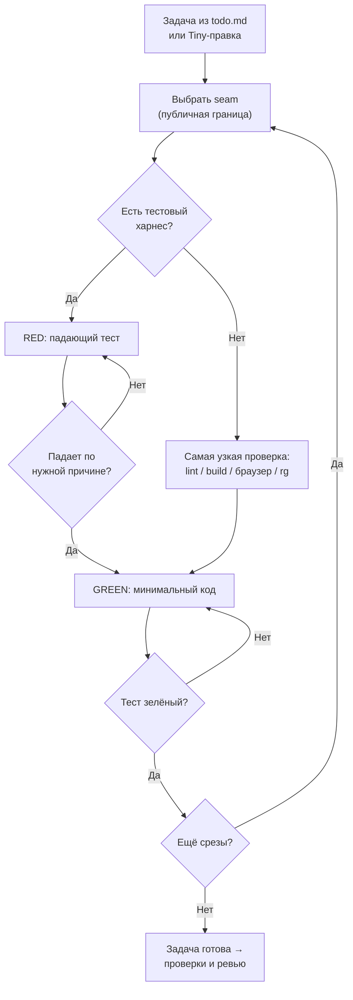

# Разработка через тесты (`tdd`)

Справочник цикла red → green для DDC CRM: что считается хорошим тестом, на каких seams его ставить,
каких анти-паттернов избегать и как запускать тесты клиента и сервера.

## Обзор

Тест проверяет поведение через публичный интерфейс, а не реализацию: код можно переписать целиком,
тест при этом не должен меняться. Работа идёт вертикальными срезами — один тест, одна минимальная
реализация, повтор. Рефакторинг в цикл не входит, он относится к этапу ревью.

## Когда применять

- Любая фича или баг-фикс, меняющие поведение: компоненты, Redux-слайсы, сервисы, эндпоинты,
  Zod-схемы.

Если честного автоматического теста нет (часть SCSS/вёрстки), до реализации пишется самая узкая
исполняемая проверка: lint, build, браузерная проверка или `rg`-скан. Ограничение фиксируется.

## Workflow



## Seams в DDC CRM

| Где | Seam | Раннер |
|---|---|---|
| `client/` | Редьюсеры и селекторы в `client/src/**/model/`, поведение компонента через `index.ts` слайса, хелперы `shared/api` | Jest: `npx jest path/to/File.test.tsx`, `npm test` |
| `server/` | Функции сервисов, контроллеры/роуты (где важна интеграция), схемы валидации | Node test runner: доменный `npm run test:*` или `node --test -r ts-node/register <file>` |
| Prisma | Через сервис, владеющий доступом к данным, без сырых запросов | — |

Полный список доменных серверных скриптов — в таблице «When Server Changes» в `AGENTS.md`.

## Анти-паттерны

- **Привязка к реализации** — моки внутренних коллабораторов, тесты приватных методов, проверка
  через БД вместо сервиса.
- **Тавтология** — ожидаемое значение вычисляется так же, как в коде.
- **Горизонтальная нарезка** — сначала все тесты, потом вся реализация.

## Структура и связанные скиллы

```
tdd/
├── README.md   # обзор и граф (этот файл)
├── SKILL.md    # правила цикла и seams
├── tests.md    # примеры хороших и плохих тестов
└── mocking.md  # когда и как мокать
```

- Вызывается из [agent-loop](../agent-loop/README.md) на этапе 3.
- Задачи приходят из [planning-and-task-breakdown](../planning-and-task-breakdown/README.md).
- Рефакторинг и проверка стандартов — в [code-review](../code-review/README.md).
