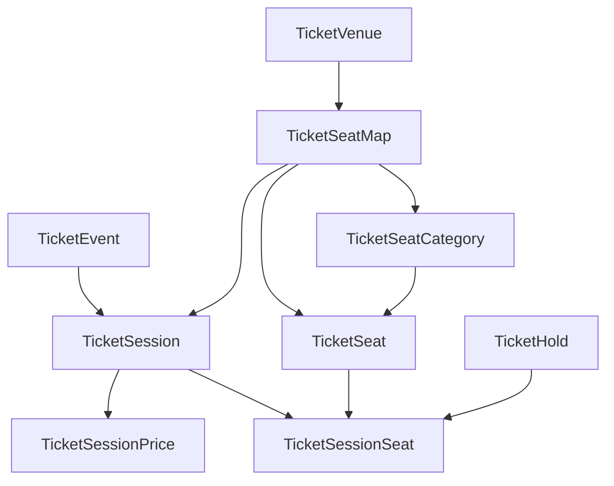

# Ticketing Domain

## Purpose

Sell concert tickets with assigned seats: venues and versioned seat maps, events and sessions,
per-session seat inventory, and temporary seat holds. Orders, payments, tickets and check-in are
planned and not implemented yet — see `docs/ticketing/IMPLEMENTATION_PLAN.md` for the phases.

## Scope

- `TicketVenue`, `TicketSeatMap`, `TicketSeatCategory`, `TicketSeat` — a venue and its versioned
  seating plan.
- `TicketEvent`, `TicketSession`, `TicketSessionPrice` — what is sold, when, and at what price.
- `TicketSessionSeat` — the inventory: one row per seat per session.
- `TicketHold` — a buyer's temporary claim on a set of seats.

## Out of Scope

- School clients and Mollie payers (`Client`, `Customer`) — a ticket buyer is a guest and is never
  written to those tables.
- Subscriptions, mandates, invoices — Ticketing shares only the Mollie client with Payments.

## Entities

### TicketSeatMap

- **Purpose**: one version of a venue's seating plan.
- **Identity**: `id`; unique on `(venueId, version)`.
- **States**: `DRAFT` → `PUBLISHED` → `ARCHIVED`.
- **Invariants**: a `PUBLISHED` version is immutable. A change means a new `DRAFT` version, so a
  session already on sale never sees its seating plan change underneath it.

### TicketSession

- **Purpose**: one performance of an event, bound to one published seat-map version.
- **States**: `DRAFT`, `ON_SALE`, `PAUSED`, `CLOSED`, `CANCELLED`.
- **Invariants**: seats can be held only while the status is `ON_SALE` and the current time is
  inside the sales window (`hold.policy.ts` → `isSalesOpen`).

### TicketSessionSeat

- **Purpose**: the allocation state of one seat in one session.
- **Identity**: composite primary key `(sessionId, seatId)`.
- **States**: `AVAILABLE` ⇄ `HELD` → `SOLD`; `AVAILABLE` ⇄ `BLOCKED`.
- **Invariants**: the primary key is what guarantees one active allocation per seat per session.
  The database also rejects inconsistent rows through `CHECK` constraints (a `HELD` seat must
  reference a hold, an `AVAILABLE` seat must reference nothing). There is deliberately no expiry
  time on the seat row — a seat stays taken until a transaction explicitly frees it.

### TicketHold

- **Purpose**: a temporary claim on one or more seats.
- **Identity**: `id`; `tokenHash` unique. Only the SHA-256 of the buyer's opaque token is stored.
- **States**: `ACTIVE` → `CONVERTED` (became an order) / `RELEASED` (buyer gave up) / `EXPIRED`.
- **Invariants**: a hold takes every requested seat or none of them, in one transaction
  (`hold.repository.ts` → `holdSeatsInTransaction`). Only `ACTIVE` holds expire.

## Domain Concepts

- **All-or-nothing hold**: one conditional `UPDATE` moves the requested seats from `AVAILABLE` to
  `HELD`; if fewer rows change than were requested, the transaction rolls back. Seat ids are
  sorted first so overlapping requests lock rows in the same order.
- **Idempotent retry**: when the client sends a `requestKey`, the hold token is derived from it
  with a server secret, so a repeated request returns the same hold instead of a seat conflict.
  Knowing the key is equivalent to knowing the token, so it must be a random string of at least
  128 bits (a UUID qualifies); shorter keys are rejected. A key whose hold is no longer live, or
  that arrives with a different set of seats, is refused.
- **Inventory generation**: publishing a session creates one inventory row per seat of its seat
  map, priced by category. Seats marked blocked on the map start as `BLOCKED`. Running it again
  changes nothing.

- **Row generator**: a seat map is created from blocks — category name, number of rows, seats
  per row. Rows are numbered continuously across blocks, shorter rows are centred, and each block
  becomes a category with its own palette slot (`seat-map.generator.ts`).
- **Draft editing**: on a `DRAFT` seat map a set of seats can be moved to another category of the
  same map and/or marked blocked by default. The change is all-or-nothing — a seat or category of
  another map rejects it — and runs under a row lock on the seat map, so it cannot land after a
  concurrent publish (`seat-map-edit.service.ts`).
- **Version clone**: any version can be cloned into the next `DRAFT` version of the same venue,
  with its own categories, seats and blocked marks. This is the only way to change a published
  map; sessions keep pointing at the version they were created on.

## API

Staff-only, under `/api/v1/ticketing/admin`, session + CSRF, roles `ADMIN` and `MANAGER`
(`ticketing.routes.ts`): list and create venues, create a seat map for a venue, read a seat map,
publish a draft, change seats of a draft (`POST /seat-maps/:id/seats`), clone a version
(`POST /seat-maps/:id/clone`). Publishing is a conditional `DRAFT → PUBLISHED` transition, so a repeated call
changes nothing. There is no public (buyer) API yet. CRM page: `client/src/pages/TicketingVenuesPage/`.

## Relationships

