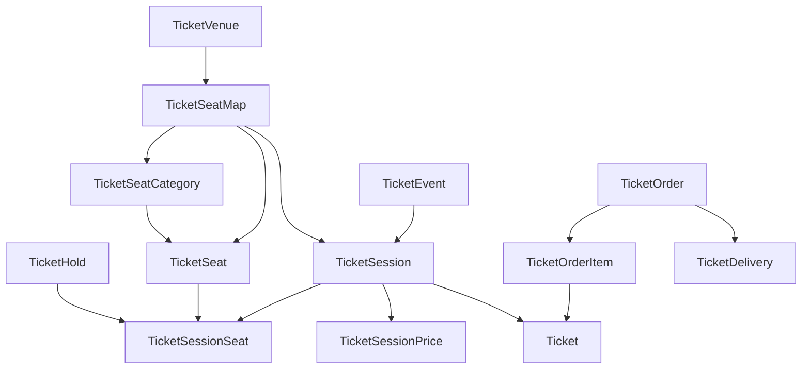

# Ticketing Domain

## Purpose

Sell concert tickets with assigned seats: venues and versioned seat maps, events and sessions,
per-session seat inventory, temporary seat holds, orders awaiting payment, Mollie checkout with
background expiry and reconciliation, and one opaque ticket per paid seat with a delivery outbox.
Public ticket lookup/PDF, email sending, recovery/resend and check-in are still planned — see
`docs/ticketing/IMPLEMENTATION_PLAN.md` for the phases.

## Scope

- `TicketVenue`, `TicketSeatMap`, `TicketSeatCategory`, `TicketSeat` — a venue and its versioned
  seating plan.
- `TicketEvent`, `TicketSession`, `TicketSessionPrice` — what is sold, when, and at what price.
- `TicketSessionSeat` — the inventory: one row per seat per session.
- `TicketHold` — a buyer's temporary claim on a set of seats.
- `TicketOrder`, `TicketOrderItem` — a buyer's order and its seats.
- `TicketPayment`, `TicketPaymentEvent` — the Mollie payment of an order and the log of webhook,
  return and reconciliation signals about it.
- `Ticket`, `TicketDelivery`, `TicketAuditLog` — the issued ticket, its delivery outbox row and the
  staff action log.

## Out of Scope

- School clients and Mollie payers (`Client`, `Customer`) — a ticket buyer is a guest and is never
  written to those tables.
- Subscriptions, mandates, invoices — Ticketing shares only the Mollie client with Payments.

## Entities

### TicketSeatMap

- **Purpose**: one version of a venue's seating plan.
- **Identity**: `id`; unique on `(venueId, version)`.
- **States**: `DRAFT` → `PUBLISHED` → `ARCHIVED`.
- **Invariants**: a `PUBLISHED` version is immutable. A change means a new `DRAFT` version, so a
  session already on sale never sees its seating plan change underneath it.

### TicketSession

- **Purpose**: one performance of an event, bound to one published seat-map version.
- **States**: `DRAFT`, `ON_SALE`, `PAUSED`, `CLOSED`, `CANCELLED`.
- **Invariants**: seats can be held only while the status is `ON_SALE` and the current time is
  inside the sales window (`hold.policy.ts` → `isSalesOpen`).

### TicketSessionSeat

- **Purpose**: the allocation state of one seat in one session.
- **Identity**: composite primary key `(sessionId, seatId)`.
- **States**: `AVAILABLE` ⇄ `HELD` → `SOLD`; `AVAILABLE` ⇄ `BLOCKED`.
- **Invariants**: the primary key is what guarantees one active allocation per seat per session.
  The database also rejects inconsistent rows through `CHECK` constraints (a `HELD` seat must
  reference a hold, an `AVAILABLE` seat must reference nothing). There is deliberately no expiry
  time on the seat row — a seat stays taken until a transaction explicitly frees it.

### TicketHold

- **Purpose**: a temporary claim on one or more seats.
- **Identity**: `id`; `tokenHash` unique. Only the SHA-256 of the buyer's opaque token is stored.
- **States**: `ACTIVE` → `CONVERTED` (became an order) / `RELEASED` (buyer gave up) / `EXPIRED`.
- **Invariants**: a hold takes every requested seat or none of them, in one transaction
  (`hold.repository.ts` → `holdSeatsInTransaction`). Only `ACTIVE` holds expire.

### TicketOrder

- **Purpose**: what a buyer is paying for — the seats of one hold, with the buyer's contact data.
- **Identity**: `id`; `number` (random, `T-XXXXXXXX`, so it reveals nothing about sales volume);
  `accessTokenHash` — only the SHA-256 of the buyer's access token is stored. The token is derived
  from the hold token, so the order number alone opens nothing.
- **States**: `PENDING_PAYMENT` → `PAID` / `EXPIRED` / `CANCELLED`; `EXPIRED` → `PAID` (late
  payment reclaimed every seat) or `NEEDS_REVIEW` (any seat already taken); `CANCELLED` → `NEEDS_REVIEW`
  on a late payment. `REFUNDED` / `PARTIALLY_REFUNDED` are planned.
- **Invariants**:
  - One order per hold (`holdId` unique). Checkout is the conditional transition
    `ACTIVE → CONVERTED` of the hold, so a repeated or parallel checkout returns the same order,
    payment row and access token (`order.repository.ts` → `convertHoldToOrder`).
  - Seats, prices and totals come from the hold and the inventory; nothing the client sends about
    amounts or seats is accepted. The database checks `total = subtotal + fee`.
  - While the order awaits payment its seats stay `HELD` by the converted hold: the hold TTL no
    longer applies and the expiry job does not release them.
  - The event, venue and seat labels are snapshotted into the order, so later edits do not change
    what was bought.
  - The buyer is stored on the order and never written to `Client` or `Customer`.
  - A payment confirms the order only when the Mollie object matches our `metadata.orderId`, saved
    amount, currency and environment mode; any mismatch or chargeback sends the order to
    `NEEDS_REVIEW` without selling seats (`payment.policy.ts` → `findPaymentMismatch`).
  - Expiry and payment signals serialize on a `FOR UPDATE` row lock on the order. A due order is
    released only after a terminal provider failure or the 60-minute hard limit; before that its
    seats stay `HELD` (`payment.repository.ts` → `expirePendingOrder`).
  - A valid paid payment is not confirmed without a ticket-signing secret. Missing
    `TICKETING_TICKET_TOKEN_SECRET` and `TICKETING_TOKEN_SECRET` sends the order to `NEEDS_REVIEW`
    with reason `TICKET_CONFIG_MISSING`; seats are not sold and no ticket is issued.

### Ticket

- **Purpose**: the right of one buyer to one assigned seat of one session.
- **Identity**: `id`; `orderItemId` unique, so every paid seat gets exactly one ticket. `codeHash`
  and `shortCode` are unique: the database rejects a repeated issue.
- **States**: `VALID` → `USED` / `VOID` (both planned for check-in and refunds).
- **Invariants**:
  - The opaque token is `v<version>.<base64url HMAC>` over the order-item id and a random 128-bit
    nonce. Only its SHA-256 hash, nonce and key version are stored; the token carries no buyer or
    seat data (`ticket.policy.ts`).
  - The whole order's tickets and one `TICKETS` delivery row are written in the same transaction
    that marks the order `PAID` and sells its seats (`payment.repository.ts` → `issueTickets`).
    A repeated webhook sees a non-pending order and issues nothing.

### TicketDelivery

- **Purpose**: durable email outbox for tickets, resends, recovery links and refund notices.
- **States**: `PENDING` → `SENDING` → `SENT` / `FAILED`.
- **Invariants**: the outbox row is created with the tickets, before any network call. A worker
  claims rows with a conditional `PENDING → SENDING` update so two runs never send the same email.

## Domain Concepts

- **All-or-nothing hold**: one conditional `UPDATE` moves the requested seats from `AVAILABLE` to
  `HELD`; if fewer rows change than were requested, the transaction rolls back. Seat ids are
  sorted first so overlapping requests lock rows in the same order.
- **Idempotent retry**: when the client sends a `requestKey`, the hold token is derived from it
  with a server secret, so a repeated request returns the same hold instead of a seat conflict.
  Knowing the key is equivalent to knowing the token, so it must be a random string of at least
  128 bits (a UUID qualifies); shorter keys are rejected. A key whose hold is no longer live, or
  that arrives with a different set of seats, is refused.
- **Inventory generation**: publishing a session creates one inventory row per seat of its seat
  map, priced by category. Seats marked blocked on the map start as `BLOCKED`. Running it again
  changes nothing.

- **Row generator**: a seat map is created from blocks — category name, number of rows, seats
  per row. Rows are numbered continuously across blocks, shorter rows are centred, and each block
  becomes a category with its own palette slot (`seat-map.generator.ts`).
- **Draft editing**: on a `DRAFT` seat map a set of seats can be moved to another category of the
  same map and/or marked blocked by default. The change is all-or-nothing — a seat or category of
  another map rejects it — and runs under a row lock on the seat map, so it cannot land after a
  concurrent publish (`seat-map-edit.service.ts`).
- **Version clone**: any version can be cloned into the next `DRAFT` version of the same venue,
  with its own categories, seats and blocked marks. This is the only way to change a published
  map; sessions keep pointing at the version they were created on.

## API

Staff-only, under `/api/v1/ticketing/admin`, session + CSRF, roles `ADMIN` and `MANAGER`
(`ticketing.routes.ts`): list and create venues, create a seat map for a venue, read a seat map,
publish a draft, change seats of a draft (`POST /seat-maps/:id/seats`), clone a version
(`POST /seat-maps/:id/clone`). Publishing is a conditional `DRAFT → PUBLISHED` transition, so a repeated call
changes nothing. CRM pages: `client/src/pages/TicketingVenuesPage/`, `TicketingEventsPage/`.

Public (buyer), under `/api/v1/ticketing/public` (`public.routes.ts`): seat map of a session
(`GET /sessions/:id` — a seat is only `AVAILABLE` or `TAKEN`), hold seats
(`POST /sessions/:id/holds`), give a hold up (`POST /holds/release`), checkout (`POST /orders`),
order status (`GET /orders/current` with the `X-Ticketing-Order-Token` header).

- No staff session and no CSRF token: the buyer has no account, so the path is CSRF-exempt and is
  protected by opaque hold / order tokens, per-IP rate limits and Turnstile on checkout (required
  whenever Turnstile is configured).
- Tokens travel in the body or a header, never in the URL, because URLs end up in access logs.
- The whole public API answers `503` until `TICKETING_SALES_ENABLED=true` and a
  `TICKETING_TOKEN_SECRET` of at least 32 characters are set. Tickets are signed with
  `TICKETING_TICKET_TOKEN_SECRET` when present, otherwise with the order secret
  (`ticketing.config.ts`).
- It is same-origin only: no extra CORS origins are opened, the storefront is expected to be
  served from the CRM front-end host.
- Checkout creates the Mollie payment with a saved idempotency key and returns the checkout URL;
  a repeated checkout returns the same order, payment and URL. The URL is hidden again after the
  payment deadline (`public.policy.ts` → `toPublicOrder`).
- Mollie posts to the separate `POST /api/v1/ticketing/webhooks/mollie` route. The webhook is
  CSRF-exempt, re-reads the payment from Mollie and returns `200` only after the order transaction
  is committed. The CRM webhook and sync skip payments marked `metadata.source='ticketing'`.
- Three opt-in cron jobs (all off by default, independent of the sales flag): hold expiry every
  minute, order closure every minute, payment reconciliation every five minutes
  (`ticketing.cron.service.ts`).

## Relationships

