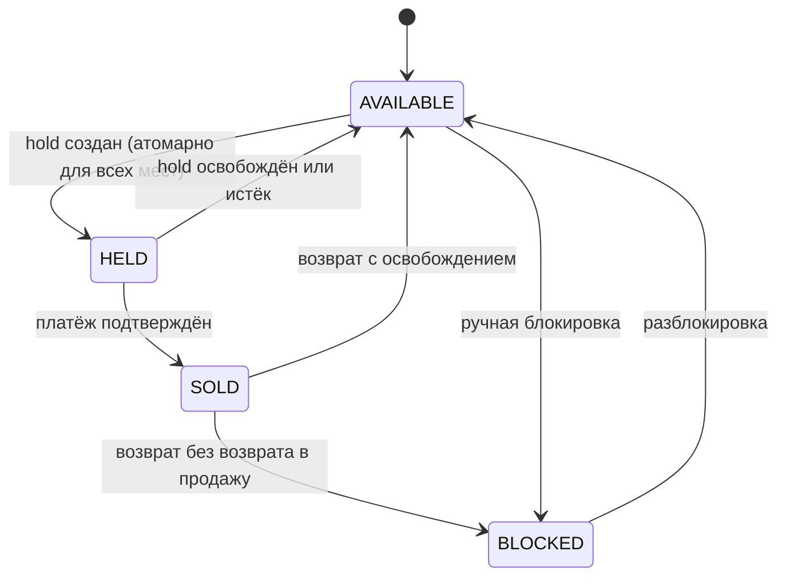
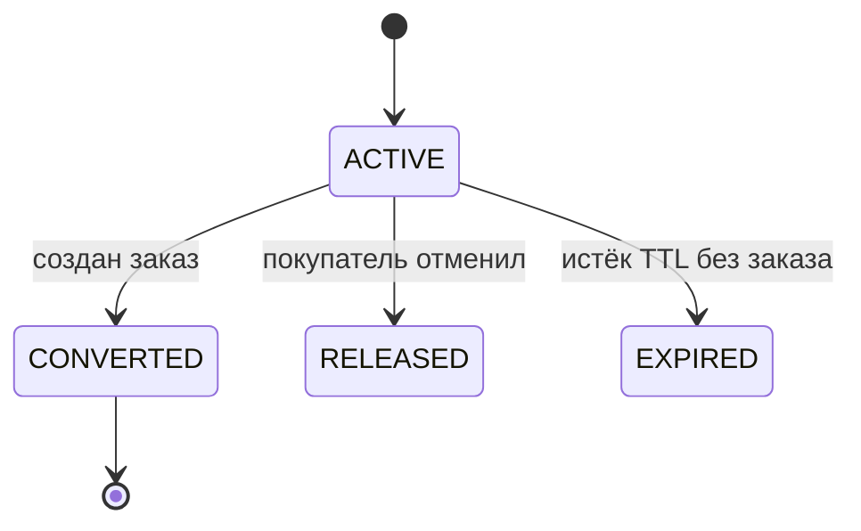
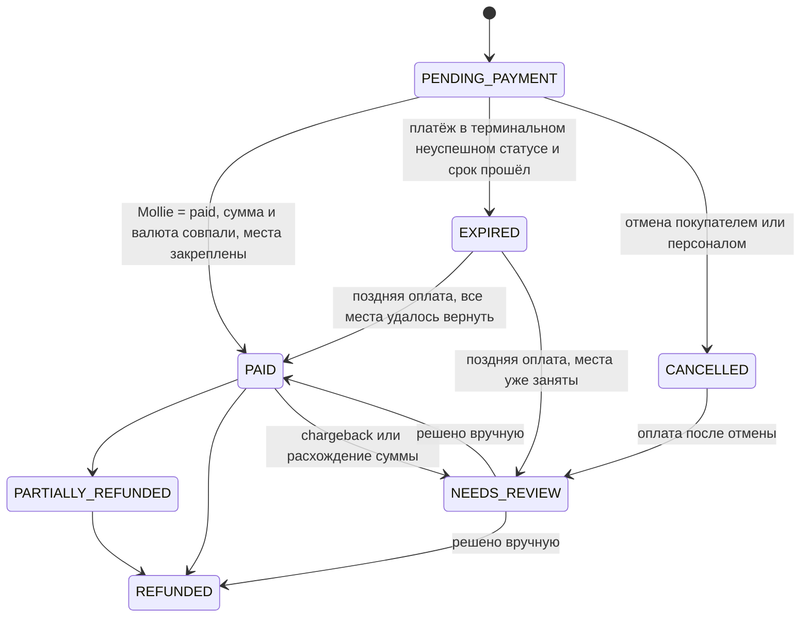
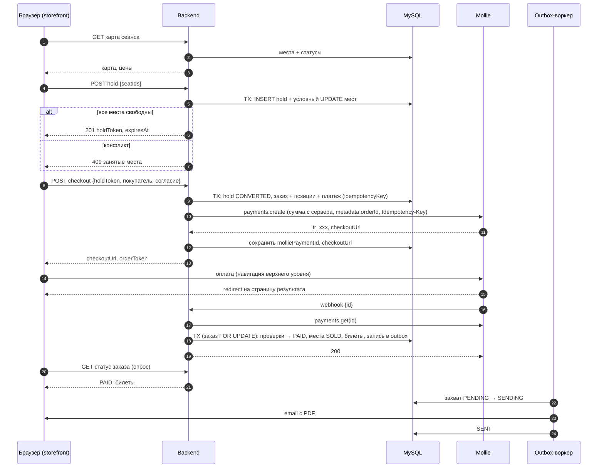
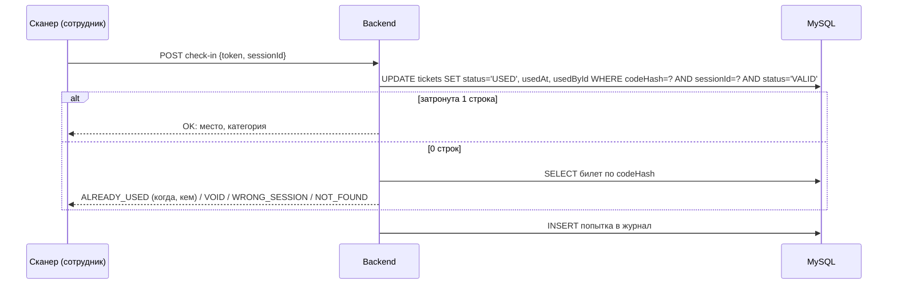

# DDC Ticketing — бронирование, оплата, возвраты, check-in (предложение)

Статус: предложение по итогам discovery. Факты о текущем коде — в `CURRENT_ARCHITECTURE.md`; модель данных — в `DATABASE_DESIGN.md`.
Обозначения: **[Факт]**, **[Предложение]**, **[Неизвестно]**.

## 1. Принципы

1. MySQL — единственный источник истины по местам, заказам и билетам. Redis — только rate-limit (как сейчас: `auth.rate-limit.service.ts`).
2. Webhook и redirect — сигналы «перечитай платёж», а не доказательство оплаты. Решение принимается только по объекту платежа, полученному от Mollie сервером (так уже устроен существующий webhook: `payments.controller.ts:602-604`).
3. Идемпотентность обеспечивается условными переходами состояний под блокировкой заказа, а не отбрасыванием «дублей».
4. Сетевые вызовы — вне транзакций БД; между ними система всегда находится в состоянии, из которого её восстановит фоновая сверка.
5. Истечение hold и истечение платежа — разные события с разными таймерами.

## 2. Как подключать Mollie: варианты

| Вариант | Суть | Плюсы | Минусы |
|---|---|---|---|
| **A. Общий профиль, отдельный webhook и таблицы** | `payments.create` с `metadata.source='ticketing'`, `webhookUrl` → новый маршрут `/api/v1/ticketing/webhooks/mollie`; данные в `ticket_payments` | Не нужны действия в кабинете Mollie; полная изоляция логики | Нужна небольшая правка существующего sync: пропускать платежи с `metadata.source='ticketing'`, иначе они попадут в `Payment` и «инциденты» (`payments.sync.service.ts:358-374`, `payments.utils.service.ts:3`) |
| B. Отдельный профиль Mollie для билетов | Свой `profileId` (поле `BusinessBrand.mollieProfileId` уже есть — `company.prisma:52`) | Раздельные выплаты и отчётность; CRM-sync не видит билетные платежи | Заведение профиля в Mollie, отдельные ключи; при OAuth-режиме нужна передача `profileId` |
| C. Переиспользовать `Payment` и общий webhook | Добавить `ticketOrderId` в `Payment` | Билеты видны в общем финансовом реестре | Тянет `ensureCustomerSynced`, Telegram «платёж Mollie», инциденты, дедуп с гонкой (`payments.controller.ts:616-664`); высокий риск регрессий в платежах школы |

**Рекомендация:** A для MVP; B — если владельцу нужна раздельная финансовая отчётность (решение бизнеса). C не рекомендуется.

Общий код, который переиспользуется во всех вариантах: `getMollieClient()` (`payments.auth.service.ts:123-155`), нормализация статусов (`payments.utils.service.ts:17-19`), расчёт нетто с учётом возвратов (`invoices.mollie.service.ts:21-38`).

**[Неизвестно] — проверить до спецификации:**
- режим подключения в проде (OAuth или API-ключ) и требование `profileId`/`testmode`;
- точные сроки жизни платежа по методам и можно ли их сократить; если нет — ограничить доступные методы параметром `method`;
- поддержка заголовка `Idempotency-Key` в `@mollie/api-client` 4.3.3 и точное имя метода создания возврата;
- политика повторов webhook у Mollie (интервалы и длительность).

## 3. Машины состояний

### 3.1 Место сеанса

### 3.2 Hold

После `CONVERTED` судьбой мест управляет заказ, TTL hold больше не действует.

### 3.3 Заказ

### 3.4 Билет

`VALID → USED` (check-in), `VALID → VOID` (возврат, chargeback, отмена), `USED → VALID` (только ручная отмена прохода с записью в аудит). `VOID` — терминальный.

## 4. Таймеры: hold против платежа

| Таймер | Предлагаемое значение (подлежит утверждению) | Что происходит по истечении |
|---|---|---|
| TTL hold (выбор мест + форма) | 10 минут, параметр сеанса | hold `ACTIVE` без заказа → `EXPIRED`, места → `AVAILABLE` |
| Окно оплаты заказа | 20 минут от создания платежа | запускается процедура закрытия (ниже), **места не освобождаются автоматически** |
| Жёсткий предел | 60 минут | заказ → `EXPIRED`, места освобождаются, платёж остаётся под наблюдением сверки |

**Процедура закрытия после окна оплаты** (фоновая задача, раз в минуту):

1. Перечитать платёж из Mollie.
2. `paid` → обычное подтверждение (§5).
3. Терминальный неуспех (`expired`, `canceled`, `failed`) → заказ `EXPIRED`, места → `AVAILABLE`.
4. `open`/`pending` → попытаться отменить платёж (существующий `cancelPaymentById` — `payments.mollie.service.ts:46-49`); если отмена удалась — п. 3.
5. Отменить нельзя и статус не терминальный → места остаются `HELD` до жёсткого предела; по его достижении места освобождаются, заказ `EXPIRED`, сверка продолжает наблюдать платёж.

**Поздняя оплата** (платёж стал `paid` для заказа в `EXPIRED`/`CANCELLED`): в одной транзакции попытаться вернуть **те же** места условным `UPDATE … WHERE status='AVAILABLE'`.
- Все места свободны → заказ `PAID`, билеты выпускаются.
- Хотя бы одно занято → откат, заказ `NEEDS_REVIEW`, уведомление персоналу; далее возврат денег по утверждённой политике (автоматический или ручной — вопрос к владельцу).

Двойная продажа невозможна в обоих случаях: место переходит в `SOLD` только условным `UPDATE` по строке с первичным ключом `(sessionId, seatId)`.

Альтернатива — никогда не освобождать места, пока платёж не терминален. Она исключает ветку поздней оплаты, но один зависший платёж блокирует места на часы или дни; отклонена в пользу жёсткого предела плюс `NEEDS_REVIEW`.

## 5. Основной сценарий

### Проверки при подтверждении платежа

Все обязательны; при любом несовпадении заказ уходит в `NEEDS_REVIEW`, билеты не выпускаются:

1. `molliePaymentId` найден в `ticket_payments` (платёж создан нами).
2. `metadata.orderId` совпадает с заказом этой записи.
3. `status = paid` (после нормализации).
4. `amount.value` и `amount.currency` равны сохранённым `amountCents`/`currency`.
5. Режим платежа (`test`/`live`) совпадает с режимом окружения.
6. Заказ в состоянии, из которого разрешён переход (§3.3).

### Идемпотентность

| Точка | Механизм |
|---|---|
| Создание hold | Повтор с тем же клиентским ключом запроса возвращает существующий hold; иначе конфликт мест даёт 409 |
| Создание заказа | `UNIQUE(holdId)` в `ticket_orders`; повтор возвращает существующий заказ и его `checkoutUrl` |
| Создание платежа | `idempotencyKey` генерируется и сохраняется **до** вызова Mollie; при таймауте повтор идёт с тем же ключом |
| Webhook | Обработка = «перечитать платёж и применить условный переход под `FOR UPDATE` заказа»; повтор и перестановка порядка безвредны |
| Выпуск билетов | `UNIQUE(orderItemId)` в `tickets`, выпуск в той же транзакции, что и `PAID` |
| Отправка email | Захват `PENDING → SENDING` условным `updateMany` (паттерн `send.persistence.ts:21-27`) |
| Возврат | Собственный `idempotencyKey`, запись создаётся до вызова Mollie |

Webhook отвечает `200` только после фиксации транзакции; при ошибке — `5xx`, чтобы Mollie повторил.

## 6. Матрица отказов и восстановления

| # | Сбой | Обнаружение | Восстановление | Итог для мест |
|---|---|---|---|---|
| 1 | Два покупателя берут одно место одновременно | счётчик затронутых строк ≠ N | проигравшему 409 | одна аллокация |
| 2 | Deadlock/таймаут блокировки при hold | ошибка 1213/1205 | до 3 повторов, затем 409 | без изменений |
| 3 | Покупатель закрыл вкладку до checkout | TTL hold | задача истечения | освобождены |
| 4 | Таймаут при `payments.create` | исключение | повтор с тем же `Idempotency-Key`; сверка ищет платёж | удержаны до закрытия |
| 5 | Платёж создан в Mollie, сбой до сохранения `molliePaymentId` | заказ без платежа старше N минут | сверка: повтор создания с тем же ключом вернёт тот же платёж | удержаны |
| 6 | Webhook не пришёл | сверка: незавершённые платежи с `lastSyncedAt` старше порога | перечитать из Mollie | по результату |
| 7 | Webhook пришёл дважды / параллельно | — | условные переходы под блокировкой | без дублей |
| 8 | Webhook вне порядка (`paid` раньше `open`) | — | состояние всегда берётся из свежего `payments.get` | корректно |
| 9 | Покупатель вернулся раньше webhook | статус `PENDING_PAYMENT` | страница опрашивает; endpoint статуса может сам инициировать перечитывание (с rate-limit) | удержаны |
| 10 | Оплата после истечения | §4 «Поздняя оплата» | авто-возврат мест или `NEEDS_REVIEW` | без двойной продажи |
| 11 | Сумма/валюта не совпали | проверки §5 | `NEEDS_REVIEW` + алерт | удержаны до решения |
| 12 | Сбой БД в транзакции подтверждения | исключение | webhook → 5xx → повтор Mollie; плюс сверка | без частичного состояния |
| 13 | Email не отправился | `ticket_deliveries.FAILED` | повторы с нарастающей задержкой, затем алерт; страница заказа и «прислать снова» работают независимо от email | — |
| 14 | Падение процесса между шагами | — | при старте те же cron-задачи доводят состояние | — |
| 15 | Возврат отклонён Mollie | статус возврата | запись `FAILED`, билеты **не** аннулируются до успеха | без изменений |
| 16 | Chargeback | webhook/сверка: `amountChargedBack > 0` | заказ `NEEDS_REVIEW`, билеты `VOID` по политике | по политике |
| 17 | Mollie недоступен при checkout | исключение | заказ отменяется, hold возвращается в `ACTIVE` с остатком TTL или освобождается; покупателю — «попробуйте позже» | освобождены/удержаны |
| 18 | Сеанс отменён организатором | действие администратора | массовый возврат через очередь возвратов | заблокированы |

### Фоновые задачи (`node-cron`, как существующие в `server/src/index.ts:18-25`)

| Задача | Период | Действие |
|---|---|---|
| Истечение hold | 1 мин | `ACTIVE` с истёкшим TTL → `EXPIRED`, освободить места |
| Закрытие заказов | 1 мин | процедура §4 |
| Сверка платежей | 5 мин | перечитать незавершённые и недавно оплаченные платежи |
| Outbox email | 1 мин | отправка и повторы |
| Проверка инвариантов | 1 час | `SOLD` без билета, `HELD` без живого hold/заказа, `PAID` без билетов → алерт |

Все задачи идемпотентны (условные `UPDATE`), поэтому безопасны при втором экземпляре процесса. Каждая включается собственным флагом окружения — как `AI_EMAIL_*_ENABLED` (`docker-compose.prod.yml`).

## 7. Билет, QR, PDF, email

- Один билет на место заказа; QR содержит только opaque-токен без PII.
- Хранение токена — варианты:

| Вариант | Плюсы | Минусы |
|---|---|---|
| **Хеш в БД + токен выводится как HMAC(секрет, ticketId ‖ nonce)** | Утечка БД не даёт валидных билетов; PDF можно пересоздать | Ротация секрета инвалидирует билеты — нужен версионированный ключ |
| Хеш в БД + токен, зашифрованный AES-GCM | Прецедент есть (`payments.auth.service.ts:30-53`) | Ключ и шифртекст лежат рядом с данными приложения |
| Токен в открытом виде | Просто (как `InvoiceDelivery.publicToken`) | Утечка БД = валидные билеты |

  Рекомендуется первый вариант.
- PDF: `pdfkit` + `qrcode` + шрифты DejaVu — библиотеки уже в проекте (`invoices.pdf.service.ts:3-4,23-38`); шаблон новый. PDF генерируется по запросу и не хранится на диске.
- Email — через outbox. Транспорт: **[Неизвестно]**, какой путь рабочий в проде — `SMTP_*` (нет в `docker-compose.prod.yml`) или `EmailAccount` из БД. Рекомендация: отправлять через `EmailAccount`-транспорт, но **без** сохранения билетных писем и вложений в `EmailMessage` (иначе каждый PDF с QR окажется в общей CRM-почте).
- Восстановление заказа: форма «email + номер заказа» всегда отвечает одинаково и шлёт новую ссылку на email заказа; rate-limit + Turnstile (`auth.captcha.service.ts`). Ссылка содержит opaque-токен заказа.
- Токены в URL попадают в логи `morgan` и nginx (`app.ts:63-67`). Меры: токен во фрагменте URL (`#`) с передачей в API заголовком, либо маскирование пути в формате лога.

## 8. Возвраты и chargeback

Юридических выводов здесь нет — только техническая механика; политика утверждается владельцем.

| Сценарий | Техническое поведение | Требует решения бизнеса |
|---|---|---|
| Полный возврат заказа | запись возврата → Mollie → при успехе билеты `VOID`, места `AVAILABLE` или `BLOCKED` | возвращать ли места в продажу автоматически |
| Частичный (отдельные места) | то же по выбранным позициям | разрешён ли вообще |
| Возврат после check-in | запрещён по умолчанию, только `ADMIN` с причиной | допустимость |
| Отмена сеанса | массовая очередь возвратов | сервисный сбор: возвращается или нет |
| Chargeback | `NEEDS_REVIEW`, алерт; билеты аннулируются по политике | автоматическая или ручная аннуляция |
| Внешний возврат (сделан в кабинете Mollie) | сверка видит `amountRefunded > 0` без нашей записи → `NEEDS_REVIEW` | — |

Создание возврата в Mollie — **новая** функциональность (`CURRENT_ARCHITECTURE.md` G1). Каждый возврат требует роли и причины и пишется в `ticket_audit_logs`.

## 9. Check-in

- Атомарность — один условный `UPDATE`; два одновременных скана дают ровно один успех.
- Только онлайн. Офлайн-режим в MVP не предлагается: атомарный запрет дублей без сервера недостижим.
- Аутентификация — обычная сессия персонала (cookie + CSRF), страница в CRM SPA, адаптированная под телефон. Библиотеки сканирования в клиенте нет — новая зависимость или `BarcodeDetector` (поддержка браузерами требует проверки на реальных устройствах).
- Ручной ввод короткого кода — fallback при плохой камере.
- Отмена прохода — только `ADMIN`/`MANAGER`, с причиной и записью в аудит.
- **[Неизвестно]** качество сети на площадке — нужен тест на месте до события.

## 10. Мониторинг и ручная сверка

| Сигнал | Порог (предложение) | Канал |
|---|---|---|
| Заказы в `NEEDS_REVIEW` | > 0 | Telegram персоналу + экран «Требуют внимания» |
| `HELD` без живого hold/заказа | > 0 | алерт |
| `PAID` без билетов | > 0 дольше 2 мин | алерт |
| Email в `FAILED` после всех повторов | > 0 | алерт |
| Ошибки webhook | > 3 подряд | алерт |
| Отставание сверки | > 15 мин | алерт |

Экран ручной сверки в CRM: по каждому проблемному заказу — состояние у нас, свежий статус Mollie, журнал событий, действия «подтвердить», «вернуть деньги», «освободить места» (все — с причиной и аудитом). Сейчас метрик и алертинга в репозитории нет (`CURRENT_ARCHITECTURE.md` §5) — минимальный вариант строится на существующих Telegram-уведомлениях персоналу.
