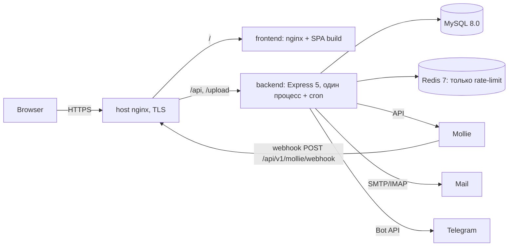

# DDC Ticketing — текущая архитектура (discovery)

Статус: discovery, только чтение. Код приложения не менялся, миграции не запускались, зависимости не ставились, `.env` не читался (только имена переменных из `.env.example`).
Дата: 2026-11-27. Ветка анализа: `develop` @ `b3a0d2b`.

Обозначения: **[Факт]** — подтверждено кодом (путь и строки указаны), **[Предложение]** — рекомендация, **[Неизвестно]** — в репозитории проверить нельзя.

`DEVELOPER.md` в репозитории отсутствует; действуют `AGENTS.md`, `CONTEXT.md`, `.claude/rules/*`.

## 1. Карта репозитория и рантайм

| Область | Факт | Доказательство |
|---|---|---|
| Монорепо | `client/` (React 19 SPA) + `server/` (Express 5 + Prisma 6), общего корневого `node_modules` нет | `CONTEXT.md:33-40`, `package.json` |
| Node | 20 (alpine) в проде и CI | `docker/server/Dockerfile.prod:1,20`, `.github/workflows/ci.yml:29,67` |
| БД | MySQL 8.0, один инстанс, один volume | `docker-compose.yml:3,12` |
| Redis | 7-alpine, AOF включён | `docker-compose.yml:24-28` |
| ORM / миграции | Prisma 6.19, схема разбита на `server/prisma/schema/*.prisma`, 25 миграций, SQL пишется/правится руками | `server/package.json`, `server/prisma/migrations/` |
| Применение миграций | при старте контейнера: `prisma migrate deploy && node build/src/index.js` | `docker/server/Dockerfile.prod:50` |
| Бэкенд-инстансы | один контейнер `backend`, cron-задачи внутри того же процесса | `docker-compose.prod.yml:19-112`, `server/src/index.ts:18-25` |
| Деплой | вручную `npm run deploy` → rsync + `docker compose up --build -d` + health-check | `docs/spec/DOCKER_PRODUCTION_DEPLOYMENT.md` |
| TLS / прокси | host nginx: `/api` и `/upload` → backend, `/` → frontend-контейнер | `deploy/nginx/ddc-nl.conf:31-55` |
| Серверный TS | `noImplicitAny`, но без `strict`/`strictNullChecks` | `server/tsconfig.json` |
| Тесты сервера | `node --test -r ts-node/register`, файлы перечисляются вручную в npm-скриптах | `server/package.json` (`test:*`, `test:ci`) |
| Тесты клиента / E2E | Jest; Playwright в изолированном compose-проекте `ddc-e2e` | `client/package.json`, `docker-compose.e2e.yml` |

## 2. Бэкенд: конвенции

- **[Факт]** Модули `server/src/modules/<name>/<name>.routes.ts → controller → service`; роутеры собираются в `server/src/routes/index.ts:27-53`, префикс `/api/v1` (`server/src/app.ts:97-98`).
- **[Факт]** Валидация — Zod, общая middleware `server/src/common/validation/validate-schema.middleware.ts`. Ошибки — `ApiError` + `error.middleware.ts`.
- **[Факт]** Жёсткий quality gate: функция ≤ 50 строк, сложность ≤ 10, ≤ 5 параметров (`.claude/rules/architecture-quality-gate.md`). Существующие `payments.controller.ts` (3252 строки) и `invoices.controller.ts` (1550 строк) — legacy-образцы, копировать их структуру нельзя; эталон — `ai-email-assistant/*`.
- **[Факт]** Деньги хранятся тремя разными способами: `Invoice.*Cents Int` (`invoice.prisma:43,60-62`), `Payment.amountValue Decimal` (`mollie.prisma:159`), `Transaction.amount Float` (`schema.prisma:27`). **[Предложение]** в Ticketing — только целые центы.

## 3. Аутентификация, RBAC, аудит, тенанты

| Тема | Факт | Доказательство |
|---|---|---|
| Сессии персонала | opaque-токен в cookie, 2FA по email, Argon2id | `server/src/modules/auth/auth.middleware.ts:11-44`, `CONTEXT.md:135-140` |
| Роли | enum из трёх значений: `ADMIN`, `MANAGER`, `DOCTOR` | `server/prisma/schema/user.prisma:1-5` |
| Проверка ролей | `requireRole(...)` существует, но применяется точечно (knowledge, AI, payment-reminders, users, security-events) | `auth.middleware.ts:53-63`; поиск `requireRole` по `server/src` |
| Mollie и счета | **все** маршруты только `isAuthenticated`, без роли — любой включённый пользователь может всё | `payments.routes.ts:8-60`, `invoices.routes.ts:24-39` |
| Гранулярных прав нет | нет таблицы permissions; на клиенте только флаг `isAdmin` для пунктов меню | `client/src/widgets/Sidebar/model/selectors/getSidebarItems.ts:23`, `PrivatRoute.tsx` (роль не проверяет) |
| CSRF | double-submit + проверка Origin на **все** небезопасные методы `/api/v1`; исключения перечислены поимённо | `server/src/modules/auth/auth.csrf.middleware.ts:17-36,52-77` |
| CORS | разрешён только `CLIENT_URL` (+ localhost в dev), `credentials: true` | `server/src/app.ts:25-28,80-85` |
| CSP бэкенда | `frame-ancestors 'self'`, `form-action 'self'` | `server/src/app.ts:34-51` |
| Аудит | `AuthSecurityEvent` (enum типов, только auth-события) и `InvoiceAuditLog` (action + old/new JSON) | `user.prisma:17-49,123-140`, `invoice.prisma:152-167` |
| Тенанты | мультитенантности нет. `LegalOrganization` — синглтон по соглашению, `BusinessBrand` — бренд-эмитент с `mollieProfileId` | `company.prisma:18-63`, `docs/domain/organization.md` |
| Rate limit | Redis при наличии `REDIS_URL`, иначе память процесса | `auth.rate-limit.service.ts:43-66,115` |
| Captcha | Cloudflare Turnstile для логина | `auth.captcha.service.ts:10-21` |

**Следствия для Ticketing [Факт → Предложение]:**

1. Публичный `POST` (hold, checkout) сейчас получит `403 CSRF token invalid`: middleware требует cookie сессии (`auth.csrf.middleware.ts:68-74`). Нужен явный exempt для префикса публичного API + собственная защита (opaque hold-token, rate-limit, Turnstile).
2. Вызовы API с домена WordPress заблокирует CORS — `PUBLIC_SITE_URL` есть в списке CSRF-origin (`auth.csrf.middleware.ts:10`), но **не** в CORS (`app.ts:25-28`).
3. Для check-in нужна роль ниже `MANAGER`. Варианты и компромиссы — в `TICKETING_SPECIFICATION.md` §6.
4. Универсального журнала аудита нет — для заказов/возвратов/check-in нужен собственный `TicketAuditLog` по образцу `InvoiceAuditLog`.

## 4. Интеграция Mollie

### 4.1 Подключение

- **[Факт]** Клиент создаётся в `getMollieClient()` (`payments.auth.service.ts:123-155`): сначала последний активный OAuth-аккаунт (`MollieAccount`, токены шифруются AES-256-GCM), иначе `MOLLIE_API_KEY ?? MOLLIE_API_KEY_LIVE`.
- **[Факт]** `MOLLIE_API_KEY_LIVE` и `MOLLIE_TOKEN_ENCRYPTION_KEY` читаются кодом, но в `docker-compose.prod.yml` в контейнер не пробрасываются (в списке `environment` их нет).
- **[Факт]** Понятия test mode в коде нет: поиск `testmode` по `server/src` пуст. Режим определяется только типом ключа/токена.
- **[Неизвестно]** Какой режим активен в проде (OAuth или API-ключ). Это важно: при OAuth-токене Mollie требует `profileId` (и `testmode` для теста) при создании платежа, а существующий код их не передаёт (`payments.mollie.service.ts:106-117`). Нужно проверить на проде и по документации Mollie до проектирования.

### 4.2 Разовые платежи против рекуррентных

| Возможность | Факт | Доказательство | Пригодность для билетов |
|---|---|---|---|
| Разовый Payment | `payments.create` c `sequenceType: oneoff`, `metadata.source='crm_payment_link'`, валюта жёстко `EUR` | `payments.mollie.service.ts:98-118` | Ближайший аналог, но привязан к `customerId` и общему webhook |
| Payment Link | `paymentLinks.create` для счетов, свой токен в query webhook-URL | `payments.mollie.service.ts:64-83`, `invoices.payment-link.service.ts:41-47,63-91` | Не подходит: нет контроля срока жизни конкретного платежа и методов |
| Подписки / мандаты | основной сценарий CRM | `payments.mollie.service.ts:196-328` | Не использовать |
| Отмена платежа | `payments.cancel`, только если `isCancelable` | `payments.mollie.service.ts:46-49`, `payments.controller.ts:2078-2110` | Адаптировать для отмены при истечении hold |
| **Создание возврата** | **отсутствует**: в коде только комментарий `// mollieClient.refunds` | `payments.controller.ts:316`; поиск `refunds.`/`createRefund` пуст | **Новое** |
| Чтение возвратов/chargeback | читаются при синхронизации платежа | `payments.sync.service.ts:72-101` | Адаптировать |
| Idempotency-Key при создании | не передаётся | `payments.mollie.service.ts:106` | **Новое** |

### 4.3 Webhook

- **[Факт]** Один маршрут `POST /api/v1/mollie/webhook` без аутентификации (`payments.routes.ts:66`), исключён из CSRF (`auth.csrf.middleware.ts:23`). Тело — `id` платежа; сервер перечитывает платёж из Mollie (`payments.controller.ts:602-604`) — корректная модель «webhook как сигнал».
- **[Факт]** Дедупликация: `MollieEvent.dedupeKey` (unique) = `id:status:paidAt:refunded:chargedBack` (`payments.utils.service.ts:21-33`); `P2002` → `200 Already processed` (`payments.controller.ts:662-664`); при ошибке ключ обнуляется (`:586-600`).
- **[Факт]** Обработка **не** в одной транзакции: `syncMolliePayment` → `markInvoicePaymentLinkPaid` → `mollieEvent.update` — отдельные запросы (`payments.controller.ts:616-641`).
- **[Факт]** Гонка: параллельный дубль получает `200`, пока первый ещё обрабатывается. Для счетов это терпимо (пересчёт идемпотентен), для выпуска билетов — нет.
- **[Факт]** Каждый webhook шлёт Telegram-уведомление «платёж Mollie», если платёж сохранён (`payments.controller.ts:571-584,638`).
- **[Факт]** Проверки суммы/валюты против ожидаемой нет — сумма просто копируется из Mollie (`payments.sync.service.ts:293-305`).

### 4.4 Сверка

- **[Факт]** Периодической сверки с Mollie нет: в `server/src/index.ts:18-25` нет cron для Mollie; синхронизация — только по кнопке (`POST /mollie/sync*`).
- **[Факт]** Полная синхронизация перебирает **все** платежи профиля (`payments.mollie.service.ts:29-38`, `payments.sync.service.ts:358-374`) и кладёт их в `Payment`.
- **[Факт]** «Инциденты» — производный запрос по `Payment.status ∈ failed/canceled/expired/charged_back` (`payments.utils.service.ts:3`, `payments.controller.ts:1809,2131`).

**Риск [Факт → вывод]:** если билетные платежи пойдут через тот же Mollie-профиль, первая же ручная синхронизация затянет их в `Payment`, а каждый брошенный checkout (`expired`/`canceled`) станет «инцидентом» в CRM и попадёт в матрицу платежей. Варианты решения — `BOOKING_AND_PAYMENT_FLOW.md` §2.

## 5. Клиенты, заказы, email, PDF, QR, задачи, наблюдаемость

| Компонент | Что есть (факт) | Доказательство | Класс | Зависимости и риски |
|---|---|---|---|---|
| Покупатель | `Client` — ученик школы; `Customer` — плательщик Mollie с `email @unique` | `client.prisma:7-35`, `mollie.prisma:49-78` | **Новое** (`TicketOrder.buyer*`) | Нельзя создавать `Client`/`Customer` на каждого гостя: `Customer.email` уникален, включится email-матчинг и Telegram-уведомления (`payments.sync.service.ts:103-120,195-212`) |
| Заказы | Сущности «заказ» нет; ближайшее — `Invoice` (+items, payments, audit) | `invoice.prisma:29-167` | **Новое** | `Invoice` не содержит НДС-полей (только `totalCents`, `issuerVatNumber`) — см. вопросы по НДС |
| Платёж | `Payment` (Mollie) с опциональными связями | `mollie.prisma:156-183` | **Новое** `TicketPayment` | Переиспользование `Payment` тянет sync/инциденты/Telegram (§4.4) |
| Журнал webhook | `MollieEvent` | `mollie.prisma:204-222` | **Адаптировать** (свой журнал или общий с `eventType`) | Семантика dedupe недостаточна для выпуска билетов |
| Email, путь A | счета: `nodemailer` по `SMTP_HOST/PORT/USER/PASSWORD/FROM`, статусы `PENDING/SENT/FAILED` | `invoices.delivery.service.ts:47-59,193-225` | **Адаптировать** паттерн доставки | `SMTP_*` нет ни в `.env.example`, ни в `docker-compose.prod.yml` → **[Неизвестно]**, работает ли в проде |
| Email, путь B | `EmailAccount` из БД, `composeEmail` сохраняет письмо и вложения в CRM-почту | `email-smtp.service.ts:23-41,91-123,172-180` | **Переиспользовать транспорт** | Каждый билет с PDF осядет в `EmailMessage`/`private-uploads` — рост хранилища и PII в общей почте |
| Очередь / повтор email | нет; отправка синхронная, повтор только вручную | `invoices.delivery.service.ts:193-225` | **Новое** (outbox + cron) | — |
| PDF | `pdfkit` + шрифты DejaVu (кириллица) | `invoices.pdf.service.ts:3,23-38` | **Переиспользовать библиотеку**, шаблон новый | — |
| QR-генерация | `qrcode` уже используется для оплаты в счёте | `invoices.pdf.service.ts:4` | **Переиспользовать** | — |
| QR-сканер (камера) | в `client/package.json` нет ни одной библиотеки сканирования | `client/package.json` | **Новое** (нужна зависимость или `BarcodeDetector`) | Решение о зависимости — на этапе спецификации |
| Публичные токены | `crypto.randomBytes(32).toString('hex')`, хранится в открытом виде, лежит в URL | `invoices.delivery.service.ts:165`, `invoices.routes.ts:26-27` | **Адаптировать** (хранить хеш) | `morgan('combined')` пишет URL в лог (`app.ts:63-67`) → токен в пути попадает в логи |
| Фоновые задачи | `node-cron` в процессе API, 8 задач | `server/src/index.ts:18-25` | **Переиспользовать** | Нет распределённой блокировки: при втором инстансе задачи задвоятся → задачи обязаны быть идемпотентными |
| Атомарный «захват» | `updateMany` с условием по статусу и проверкой `count === 1` | `ai-email-assistant/send.persistence.ts:21-27` | **Переиспользовать паттерн** | — |
| Блокировка строки | `SELECT … FOR UPDATE` через `$queryRaw` внутри `$transaction` | `auth/telegram-miniapp/telegram-miniapp-identity.service.ts:20-27` | **Переиспользовать паттерн** | Единственный прецедент в коде |
| Уровень изоляции / retry | нигде не задаётся; повторов при deadlock нет | поиск `isolationLevel` пуст | **Новое** | — |
| Redis | только счётчики rate-limit | `auth.rate-limit.service.ts` (единственный потребитель) | Опционально | Соответствует брифу: MySQL — источник истины |
| Логи | winston в файлы внутри контейнера + `morgan`; в Mollie-коде `console.log` | `common/logger/index.ts`, `payments.controller.ts:657` | Адаптировать | Каталог логов не вынесен в volume (`docker-compose.prod.yml:97-102`) |
| Метрики / алерты | в репозитории нет | — | **Новое / [Неизвестно]** | В комментарии nginx упомянуты «monitoring containers» на хосте (`deploy/nginx/ddc-nl.conf:8`), конфигурации нет |
| Уведомления персоналу | Telegram с переключателями по типам | `docs/spec/DDC_CRM_TELEGRAM_NOTIFICATIONS_SPEC.md` | Переиспользовать для ops-алертов | Клиентский Telegram в брифе отложен; служебные алерты — отдельный вопрос |
| Бэкапы | автоматических бэкапов в репозитории нет; `backups/` — локальные ручные дампы | `scripts/deploy-docker.sh:84`, `backups/` | **[Неизвестно]** | Блокер готовности к продаже — см. план |

## 6. Фронтенд CRM

- **[Факт]** FSD-слои, роуты в `client/src/shared/config/routeConfig/routeConfig.tsx`, меню — `getSidebarItems.ts`. Все роуты либо `authOnly`, либо «только для гостя» (`AppRouter.tsx:13-17`) — нейтрального публичного типа роута нет.
- **[Факт]** Дизайн-система: токены `*-redesigned`, SCSS-модули, тёмная тема (`.claude/rules/code-style.md`). Готовые `shared/ui`: `Modal`, `Card`, `Tabs`, `Select`, `Input`, `Button`, `Skeleton`, `StateView` и др.
- **[Факт]** i18n: `fallbackLng: 'en'`, локали только `en` и `ru` (`client/public/locales/`). **Нидерландской локали нет.**
- **[Факт]** `@use-gesture/react` и `@react-spring/web` есть в зависимостях (`client/package.json`), использований `use-gesture` в `client/src` поиск не нашёл.
- **[Факт]** Прецедент отдельного лёгкого бандла: `client/telegram-mini-app/` (esbuild, без зависимостей), собирается в `build:prod` и раздаётся frontend-nginx (`client/package.json` → `build:prod`, `CONTEXT.md:161`).
- **[Факт]** Frontend-nginx не выставляет ни CSP, ни `X-Frame-Options` (`docker/client/nginx/default.conf`) — статический бандл можно встроить в iframe уже сейчас; API при этом отдаёт `frame-ancestors 'self'`, но на XHR это не влияет.

## 7. WordPress

Обновлено 2026-11-27: владелец дал доступ к локальной копии темы (отдельный git-репозиторий, ветка `main`, вне этого репозитория). Осмотр — только чтение.

| Тема | Факт | Доказательство (путь внутри темы `wp-content/themes/ddc_nl`) |
|---|---|---|
| Версия WordPress | 6.8.3 | `wp-includes/version.php` |
| Тема | собственная «DDC NL 2025» на Bootstrap 5, SCSS, свои `AGENTS.md`/`CONTEXT.md` | `style.css`, `AGENTS.md` |
| Языки сайта | четыре: `ru`, `nl`, `uk`, `en`; текущий язык — через Polylang | `includes/i18n.php` (`ddc_normalize_language_code`) |
| Плагины | Polylang, W3 Total Cache, Elementor, WooCommerce, Contact Form 7, All in One SEO и др. | `wp-content/plugins/` |
| Шорткоды темы | собственных `add_shortcode` в теме поиск не нашёл | поиск по `*.php` темы |
| Заголовки CSP / `X-Frame-Options` | в теме не выставляются | поиск по `*.php` темы |
| Возврат после оплаты | по умолчанию ведёт на корень публичного сайта | `server/src/modules/payments/payments.mollie.service.ts:17-20` |

Следствия:

- Витрине нужны **четыре** языка (добавляется украинский), а не три, как предполагалось в брифе; язык передаётся из Polylang в параметр встраивания.
- W3 Total Cache кэширует страницы целиком — довод в пользу iframe: страница с шорткодом статична, а динамика живёт внутри фрейма. Страницу результата оплаты нужно исключить из кэша либо читать параметр заказа на стороне клиента.
- На сайте установлен WooCommerce. Ticketing его **не использует** (решение владельца: отдельный модуль в CRM); в теме есть шаблоны корзины и оформления (`templates/cart.php`, `templates/checkout.php`) — их не трогаем.
- Тема — рабочий сайт со своими правилами для агентов (минимальные проверяемые правки, ответы на русском); изменения там делаются отдельной веткой и PR в её репозитории.

**[Неизвестно]** остаётся: заголовки безопасности и CSP на уровне веб-сервера прод-сайта, настройки W3 Total Cache в проде.

## 8. Сводка пробелов

| # | Пробел | Критичность |
|---|---|---|
| G1 | Нет создания возвратов через Mollie | Высокая |
| G2 | Нет периодической сверки платежей и idempotency-ключей | Высокая |
| G3 | Публичные `POST` блокируются CSRF; CORS не пускает домен сайта | Высокая (решаемо) |
| G4 | Нет роли для check-in и гранулярных прав | Средняя |
| G5 | Нет outbox/повторов email; прод-конфигурация SMTP не подтверждена | Высокая |
| G6 | Нет NL-локали, нет публичного типа роута | Средняя |
| G7 | Нет автоматических бэкапов и мониторинга в репозитории | Высокая для продаж |
| G8 | Нет test mode Mollie и staging-контура для платежей | Высокая |
| G9 | Билетные платежи загрязнят `Payment`/инциденты при общем профиле | Средняя |
| G10 | Репозиторий WordPress недоступен — **снято 2026-11-27**, см. §7 | — |
