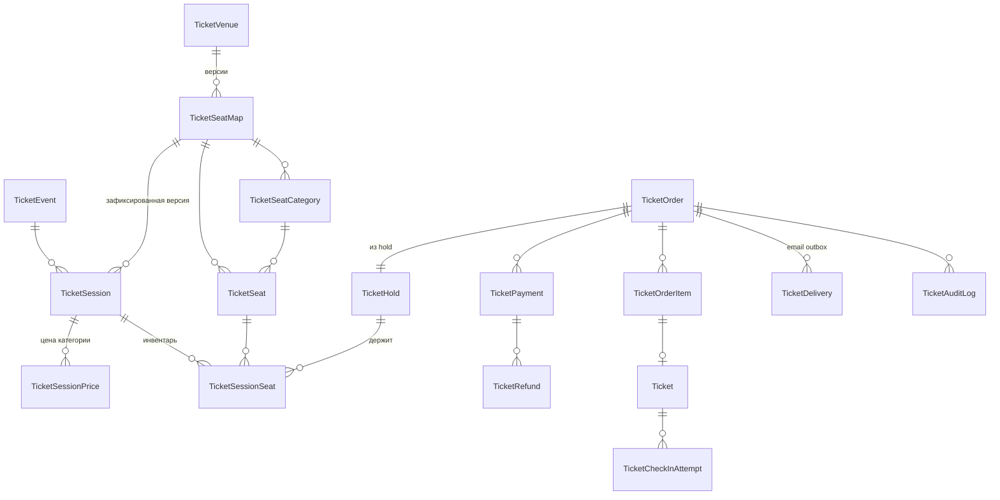

# DDC Ticketing — проект базы данных (предложение)

Статус: предложение по итогам discovery. Ни одна миграция не создана и не запущена.
Факты о текущей схеме — в `CURRENT_ARCHITECTURE.md`. Всё ниже — **[Предложение]**, если не помечено иначе.

## 1. Ограничения платформы, влияющие на дизайн

| Ограничение | Источник | Следствие |
|---|---|---|
| MySQL 8.0, InnoDB | `docker-compose.yml:3` | Нет частичных (partial) уникальных индексов → «одна активная аллокация» нельзя выразить как `UNIQUE … WHERE status='active'` |
| Prisma 6 | `server/package.json` | Нет `SELECT … FOR UPDATE` в API — только `$queryRaw` (прецедент: `telegram-miniapp-identity.service.ts:20-27`); `CHECK`-ограничения в схеме не описываются — добавляются руками в SQL миграции |
| Миграции накатываются при старте контейнера | `docker/server/Dockerfile.prod:50` | Down-миграций нет; каждая миграция должна быть аддитивной и безопасной для отката образа |
| Локальный `prisma migrate dev` недоступен агенту (нет прав на shadow-DB) | практика проекта | `migrate diff` + ручной SQL + `migrate deploy` |
| Один процесс бэкенда | `docker-compose.prod.yml` | Конкуренция — между HTTP-запросами и cron в одном процессе; дизайн при этом не должен ломаться при втором инстансе |

## 2. Ключевое решение: материализованный инвентарь

Каждое место каждого сеанса — отдельная строка `ticket_session_seats`. Инвариант «одна активная аллокация на сеанс/место» обеспечивается **первичным уникальным ключом `(sessionId, seatId)`** — строка одна, и её статус и есть аллокация.

| Вариант | Плюсы | Минусы | Вердикт |
|---|---|---|---|
| **A. Строка на место сеанса со статусом** | Уникальность даёт сама БД; hold — один условный `UPDATE`; просто читать карту | 260 строк на сеанс создаются при публикации | **Рекомендуется** |
| B. Таблица аллокаций + «активный» nullable-столбец в уникальном индексе | История аллокаций бесплатно | Трюк с `NULL` в unique-индексе хрупок, легко сломать ручной правкой | Отклонён |
| C. Блокировка строки сеанса (`FOR UPDATE`) | Нет deadlock | Все покупатели сеанса сериализуются; узкое место при старте продаж | Запасной вариант |
| D. Redis-блокировки | Быстро | Противоречит брифу («never rely on Redis alone»); AOF не даёт транзакционной связи с MySQL | Отклонён |

Объём: 260 мест × сеанс — ничтожно для MySQL; даже 50 сеансов = 13 000 строк.

## 3. ERD



## 4. Таблицы

Имена таблиц — `ticket_*` в snake_case через `@@map` (как в новых моделях: `mandate_documents`, `invoice_deliveries`). Новый файл схемы `server/prisma/schema/ticketing.prisma`. Все суммы — `Int` в центах, валюта — `CHAR(3)`.

### 4.1 Площадки и схемы зала (версионируемые)

**`ticket_venues`** — `id`, `name`, `address`, `isActive`, timestamps.

**`ticket_seat_maps`** — версия схемы зала.
`id`, `venueId`, `version Int`, `status ENUM(DRAFT, PUBLISHED, ARCHIVED)`, `name`, `canvas JSON` (размеры полотна, сцена, подписи — только декор), `publishedAt`, `publishedById`.
Ограничение: `UNIQUE(venueId, version)`.

**`ticket_seat_categories`** — `id`, `seatMapId`, `code`, `name`, `colorSlot TINYINT` (1…8 → токены `--style-N-*-redesigned`, сырой цвет не хранится), `sortOrder`. `UNIQUE(seatMapId, code)`.

**`ticket_seats`** — `id`, `seatMapId`, `categoryId`, `sectionLabel`, `rowLabel`, `seatLabel`, `x`, `y`, `rotation`, `isAccessible`, `isDefaultBlocked`.
Ограничение: `UNIQUE(seatMapId, sectionLabel, rowLabel, seatLabel)`.

**Версионирование.** `PUBLISHED`-версия неизменяема: сервис отклоняет любые изменения мест/категорий опубликованной схемы. Правка = «клонировать в новую `DRAFT`-версию». Сеанс ссылается на конкретный `seatMapId`, поэтому изменение зала никогда не затрагивает уже продающиеся сеансы — это закрывает инвариант брифа «do not silently change published seating plans».
Альтернатива — хранить всю схему одним JSON-документом на версию: проще редактор, но теряются внешние ключи от инвентаря к месту; отклонено.

### 4.2 События, сеансы, цены

**`ticket_events`** — `id`, `slug UNIQUE`, `title`, `description TEXT`, `posterUrl`, `businessBrandId` (эмитент, ссылка на существующий `BusinessBrand`), `status ENUM(DRAFT, PUBLISHED, ARCHIVED)`, timestamps, `createdById`.

**`ticket_sessions`** — `id`, `eventId`, `seatMapId`, `startsAt`, `doorsAt`, `salesStartAt`, `salesEndAt`, `status ENUM(DRAFT, ON_SALE, PAUSED, CLOSED, CANCELLED)`, `holdTtlSeconds`, `maxSeatsPerOrder`, `currency`, `inventoryGeneratedAt`.

**`ticket_session_prices`** — `sessionId`, `categoryId`, `priceCents`. `PRIMARY KEY(sessionId, categoryId)`.
Цена задаётся на категорию в сеансе; при генерации инвентаря копируется в строку места, чтобы поддержать точечные исключения без отдельной таблицы.

### 4.3 Инвентарь

**`ticket_session_seats`**

| Колонка | Тип | Назначение |
|---|---|---|
| `sessionId`, `seatId` | Int | `PRIMARY KEY(sessionId, seatId)` — главный инвариант |
| `status` | ENUM(`AVAILABLE`, `HELD`, `SOLD`, `BLOCKED`) | текущее состояние |
| `holdId` | Int NULL | кто держит (FK → `ticket_holds`) |
| `orderItemId` | Int NULL UNIQUE | кому продано |
| `priceCents` | Int | цена места в этом сеансе |
| `blockReason` | VARCHAR NULL | причина ручной блокировки |
| `version` | Int | счётчик изменений для отладки и оптимистичных проверок |
| `updatedAt` | DateTime | |

Индексы: `(sessionId, status)` для карты и отчётов; `(holdId)` для освобождения.

`CHECK`-ограничения (ручной SQL в миграции, MySQL ≥ 8.0.16 их применяет):
- `status='HELD'` ⇒ `holdId IS NOT NULL`;
- `status='SOLD'` ⇒ `orderItemId IS NOT NULL`;
- `status IN ('AVAILABLE','BLOCKED')` ⇒ оба `NULL`.

Срока hold в строке места **нет** намеренно: единственный источник срока — `ticket_holds.expiresAt`. Место считается занятым, пока его не освободит явная транзакция; «ленивого» истечения по времени на чтении нет — иначе возникает гонка с поздней оплатой (см. `BOOKING_AND_PAYMENT_FLOW.md` §4).

### 4.4 Hold, заказ, платёж

**`ticket_holds`** — `id`, `sessionId`, `tokenHash CHAR(64) UNIQUE` (SHA-256 от opaque-токена; сам токен не хранится), `status ENUM(ACTIVE, CONVERTED, RELEASED, EXPIRED)`, `expiresAt`, `seatCount`, `clientIpHash`, `createdAt`, `releasedAt`.
Индекс `(status, expiresAt)` — для задачи истечения.

**`ticket_orders`**

- Идентичность: `id`, `number VARCHAR UNIQUE` (человекочитаемый), `accessTokenHash CHAR(64) UNIQUE`.
- Связи: `sessionId`, `holdId UNIQUE` (один заказ на hold — идемпотентность создания).
- Покупатель: `buyerName`, `buyerEmail`, `buyerPhone NULL`, `locale`.
- Деньги: `subtotalCents`, `feeCents`, `totalCents`, `currency`, `refundedCents`.
- Состояние: `status ENUM(PENDING_PAYMENT, PAID, CANCELLED, EXPIRED, REFUNDED, PARTIALLY_REFUNDED, NEEDS_REVIEW)`, `paymentDeadlineAt`, `paidAt`, `cancelledAt`, `reviewReason`.
- Снимок: `eventSnapshot JSON` (название события, площадка, адрес, дата/время, эмитент) — фиксируется в момент создания.
- Согласия: `termsAcceptedAt`, `termsVersion`.
- Индексы: `(buyerEmail)`, `(sessionId, status)`, `(status, paymentDeadlineAt)`.

Покупатель хранится в заказе, **не** в `Client`/`Customer` — обоснование в `CURRENT_ARCHITECTURE.md` §5.

**`ticket_order_items`** — `id`, `orderId`, `sessionId`, `seatId`, снимки `sectionLabel`, `rowLabel`, `seatLabel`, `categoryName`, `priceCents`, `status ENUM(ACTIVE, CANCELLED, REFUNDED)`.
`UNIQUE(orderId, seatId)`.

**`ticket_payments`** — `id`, `orderId`, `molliePaymentId VARCHAR UNIQUE NULL`, `idempotencyKey CHAR(36) UNIQUE`, `status` (нормализованный статус Mollie), `amountCents`, `currency`, `method NULL`, `checkoutUrl TEXT`, `mollieExpiresAt`, `paidAt`, `refundedCents`, `chargedBackCents`, `lastSyncedAt`, `mollieMode ENUM(TEST, LIVE)`.
Индексы: `(orderId)`, `(status, lastSyncedAt)` для сверки.

**`ticket_refunds`** — `id`, `paymentId`, `mollieRefundId UNIQUE NULL`, `idempotencyKey UNIQUE`, `amountCents`, `status`, `reason`, `releaseSeats BOOLEAN`, `createdById`, timestamps.

**`ticket_payment_events`** — журнал webhook/сверки: `id`, `molliePaymentId`, `source ENUM(WEBHOOK, RECONCILE, RETURN)`, `observedStatus`, `payload JSON`, `outcome`, `errorMessage`, `receivedAt`, `processedAt`.
Только журнал, **без** уникального dedupe-ключа: идемпотентность обеспечивают переходы состояний под блокировкой заказа, а не отбрасывание дублей (существующая схема `MollieEvent.dedupeKey` отвечает дублю `200` ещё до завершения первой обработки — `payments.controller.ts:662-664`).

### 4.5 Билеты и check-in

**`tickets`** — `id`, `orderItemId UNIQUE` (ровно один билет на место заказа), `sessionId`, `codeHash CHAR(64) UNIQUE` (SHA-256 от opaque-токена ≥ 128 бит), `shortCode VARCHAR UNIQUE` (для ручного ввода), `status ENUM(VALID, USED, VOID)`, `issuedAt`, `usedAt`, `usedById`, `voidedAt`, `voidReason`.

В QR кладётся только opaque-токен (или URL с ним) — без имени, email, места. Хранение хеша означает, что токен нельзя восстановить из БД: PDF генерируется из детерминированного вывода — варианты в `BOOKING_AND_PAYMENT_FLOW.md` §7.

**`ticket_check_in_attempts`** — `id`, `ticketId NULL`, `sessionId`, `result ENUM(OK, ALREADY_USED, VOID, WRONG_SESSION, NOT_FOUND)`, `scannedById`, `deviceLabel`, `createdAt`. Журнал каждого сканирования, включая неудачные.

### 4.6 Доставка и аудит

**`ticket_deliveries`** — outbox email: `id`, `orderId`, `type ENUM(TICKETS, RESEND, REFUND_NOTICE, RECOVERY_LINK)`, `status ENUM(PENDING, SENDING, SENT, FAILED)`, `recipientEmail`, `attempts`, `nextAttemptAt`, `lastError`, `sentAt`, `createdById NULL`.
Индекс `(status, nextAttemptAt)`. Образец статусов — `InvoiceDelivery` (`invoice.prisma:88-113`); захват — паттерн `claimForSending` (`send.persistence.ts:21-27`).

**`ticket_audit_logs`** — `id`, `entityType`, `entityId`, `action`, `oldValues JSON`, `newValues JSON`, `actorId NULL`, `createdAt`. Образец — `InvoiceAuditLog` (`invoice.prisma:152-167`). Индекс `(entityType, entityId, createdAt)`.

## 5. Транзакции и блокировки

Общие правила:

1. Порядок блокировок фиксирован: **`ticket_orders` → `ticket_holds` → `ticket_session_seats` (по возрастанию `seatId`) → `tickets`**. Ни одна транзакция не берёт их в другом порядке.
2. Сетевые вызовы (Mollie, SMTP) **никогда** не выполняются внутри транзакции БД.
3. Уровень изоляции — `READ COMMITTED` для транзакций инвентаря (задаётся явно в `prisma.$transaction(..., { isolationLevel })`): условные `UPDATE` по первичному ключу не нуждаются в gap-блокировках `REPEATABLE READ`, а именно они — основной источник deadlock.
4. Повтор при deadlock/таймауте блокировки (MySQL 1213/1205, Prisma `P2034`): до 3 попыток с джиттером 20–100 мс, затем `409` «места заняты, попробуйте снова».
5. Короткий `lock_wait_timeout` на транзакцию hold (порядка 2–3 с), чтобы запросы не копились.

### 5.1 Создание hold (всё или ничего)

```sql
-- внутри одной транзакции, seatIds отсортированы по возрастанию
INSERT INTO ticket_holds (...) VALUES (...);

UPDATE ticket_session_seats
   SET status = 'HELD', holdId = :holdId, version = version + 1
 WHERE sessionId = :sessionId
   AND seatId IN (:sortedSeatIds)
   AND status = 'AVAILABLE';
-- affectedRows <> N  → ROLLBACK, вернуть 409 со списком недоступных мест
```

Один оператор `UPDATE … IN (…)` по первичному ключу блокирует строки в порядке индекса, поэтому два пересекающихся запроса не образуют цикл ожидания в типовом случае; повтор из п. 4 закрывает остаточные случаи.

| Стратегия | Суть | Компромисс |
|---|---|---|
| **Условный `UPDATE` + проверка счётчика** | Оптимистично, без предварительного чтения | **Рекомендуется.** Нужен второй запрос, чтобы сообщить, какие именно места заняты |
| `SELECT … FOR UPDATE ORDER BY seatId`, затем `UPDATE` | Явный порядок блокировок | Два обращения, блокировки держатся дольше |
| `FOR UPDATE SKIP LOCKED` | Не ждать занятых строк | Полезно для «лучших свободных мест», для выбора конкретных мест не нужно |
| Блокировка строки сеанса | Полная сериализация | Простой fallback, если нагрузочный тест покажет deadlock-шторм |

### 5.2 Остальные транзакции (кратко)

| Операция | Блокирует | Условие перехода |
|---|---|---|
| Hold → заказ | `ticket_holds` (`FOR UPDATE`) | `status='ACTIVE' AND expiresAt > NOW()`; `UNIQUE(holdId)` в заказе защищает от двойного создания |
| Платёж подтверждён | `ticket_orders` (`FOR UPDATE`) | заказ `PENDING_PAYMENT`, места `HELD` этим hold → `SOLD` + создание билетов; иначе ветка `NEEDS_REVIEW` |
| Истечение hold | `ticket_orders`/`ticket_holds` | только если нет открытого платежа — правила в `BOOKING_AND_PAYMENT_FLOW.md` §4 |
| Check-in | — | один `UPDATE tickets SET status='USED' … WHERE codeHash=? AND status='VALID' AND sessionId=?`; `affectedRows=1` — единственный успех |
| Возврат | `ticket_orders` (`FOR UPDATE`) | билеты → `VOID`, места → `AVAILABLE`/`BLOCKED` по политике |

## 6. Стратегия миграций

1. Одна аддитивная миграция «только новые таблицы» — существующие таблицы не меняются, кроме обратных связей Prisma на `User`/`BusinessBrand` (без изменения их колонок).
2. Изменение enum `UserRole` (если выбран вариант с новой ролью) — отдельной миграцией: `ALTER TABLE users MODIFY role ENUM(...)` на маленькой таблице безопасен, но его нужно согласовать отдельно.
3. `CHECK`-ограничения дописываются в SQL миграции вручную; Prisma их не видит, поэтому фиксируются комментарием в `ticketing.prisma` и в `docs/schema.md` (ведётся вручную — `AGENTS.md`).
4. Откат: образ с прошлой версией кода игнорирует новые таблицы, поэтому откат кода не требует отката схемы. Удаление таблиц — только отдельной явной миграцией после решения владельца.
5. Перед первой миграцией на проде — подтверждённый бэкап и проверенное восстановление (сейчас не подтверждено, см. `CURRENT_ARCHITECTURE.md` G7).
6. После появления `ticketing.prisma` — `npm run prisma:generate`, обновление `docs/schema.md`, `docs/domain/` (новый контекст `ticketing`) и `npm run graphify:specs` (новый Prisma-домен — триггер из `AGENTS.md`).

## 7. Хранение и приватность данных

- В БД не хранятся: opaque-токены в открытом виде, данные карт, полный IP (только хеш с солью для rate-limit-аналитики).
- PII покупателя сосредоточено в `ticket_orders`; срок хранения и процедура анонимизации — вопрос к владельцу (см. `TICKETING_SPECIFICATION.md` §9). Схема допускает анонимизацию: снимки мест и суммы остаются, `buyer*` обнуляются.
- JSON-снимок события делает заказ самодостаточным для отчётности после архивации события.

## 7a. Уточнения, найденные при реализации фазы 1

- **CHECK и внешний ключ.** MySQL отклоняет `CHECK` по колонке, которая участвует во внешнем ключе с каскадным действием. Prisma по умолчанию создаёт `ON UPDATE CASCADE`, поэтому связь `ticket_session_seats.hold_id` объявлена с `onUpdate: Restrict`. То же правило придётся соблюсти для `order_item_id`, когда появится его внешний ключ.
- **Идемпотентность hold без отдельной колонки.** Токен hold при наличии клиентского `requestKey` выводится как HMAC(секрет, сеанс, ключ), поэтому повтор находится по `tokenHash`; отдельное поле ключа запроса не понадобилось.
- **Маркер отката.** Серверный TypeScript компилируется в ES5, где `instanceof` для наследников `Error` не работает; откат «не все места свободны» распознаётся по полю `code`.
- **Объём миграции.** В фазе 1 созданы только таблицы залов, событий, сеансов, инвентаря и hold. Таблицы заказов, платежей, билетов, доставки и аудита из §4.4–4.6 — следующая миграция (фаза 3).

## 8. Открытые вопросы по данным

1. Нужна ли цена на уровне отдельного места (исключения из категории) в MVP или достаточно цены категории?
2. Формат номера заказа и нужна ли сквозная нумерация по годам (как у счетов).
3. Освобождать ли места в продажу автоматически после возврата или переводить в `BLOCKED` до решения администратора.
4. Нужен ли отдельный налоговый документ на заказ (см. НДС в спецификации) — если да, появится связь с `Invoice` или собственная таблица.
