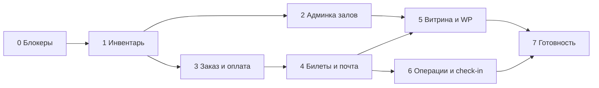

# DDC Ticketing — план реализации и оценка осуществимости

Статус: рекомендации утверждены владельцем 2026-11-27; идёт фаза 1 (см. §0).
Связанные документы: `CURRENT_ARCHITECTURE.md`, `TICKETING_SPECIFICATION.md`, `DATABASE_DESIGN.md`, `BOOKING_AND_PAYMENT_FLOW.md`.

## 0. Решения владельца и ход работ

Утверждено 2026-11-27: Ticketing — отдельный модуль со своим API и таблицами, рекомендации R1–R10 приняты.

| Блокер | Статус | Ответ владельца |
|---|---|---|
| B1 Режим Mollie | Частично снят | Подключение по API-ключу → `profileId` не нужен. Тестовый ключ для песочницы ещё не получен |
| B2 Сроки платежей, idempotency, возвраты | Открыт | Проверяется в песочнице перед фазой 3 |
| B3 Исходящая почта | Снят | Письма в проде уходят. Какой именно канал (`SMTP_*` или `EmailAccount`) — уточнить перед фазой 4 |
| B4 Бэкапы | Снят | Бэкапы на VPS есть. Проверка восстановления остаётся в фазе 7 |
| B5 Цены, НДС, сборы, возвраты, эмитент | Открыт | Нужно до фазы 3 |
| B6 Схема зала | Снят | Площадка и схема подтверждены; сами данные рассадки понадобятся в фазе 2 |
| B7 WordPress | Снят | Локальная копия темы доступна разработчику |

Фаза 1 (ветка `feat/ticketing-inventory-core`):

- [x] Схема `ticketing.prisma` и миграция `20261127120000_add_ticketing_inventory` (только новые таблицы и `CHECK`).
- [x] Ядро инвентаря: атомарный hold, освобождение, истечение, повтор при deadlock, генерация инвентаря.
- [x] Модульные тесты (`npm run test:ticketing`, включены в `test:ci`).
- [x] Интеграционные тесты на MySQL 8.0 (`npm run test:ticketing:db`): 500 параллельных попыток на 260 мест — без двойных и частичных удержаний.

По решению владельца PR в `develop` не открываются до полной готовности всего модуля: все фазы
развиваются и тестируются в одной ветке `feat/ticketing`. Ранее созданный PR #190 закрыт.

Фаза 2 (та же ветка `feat/ticketing` — по решению владельца весь модуль развивается и тестируется в ней):

- [x] Админ-API `/api/v1/ticketing/admin`: площадки, создание схемы зала генератором рядов, просмотр, публикация (роли `ADMIN`, `MANAGER`).
- [x] Страница CRM «Билеты → Залы»: список площадок, форма генератора, SVG-просмотр схемы, публикация.
- [x] Точечное редактирование схемы: блокировка отдельных мест, смена категории места, клонирование версии (API `/seat-maps/:id/seats`, `/seat-maps/:id/clone`; на странице «Залы» — выбор мест на схеме черновика и «Создать новую версию» у опубликованной). Перемещение и удаление мест, новые категории в существующей схеме — не сделаны.
- [x] События и сеансы: админ-API (`/events`, `/events/:id/sessions`, `/sessions/:id`, `/publish`, `/status`), страница CRM «Билеты → События», цены по категориям, публикация сеанса с идемпотентной генерацией инвентаря, пауза / возобновление / закрытие продажи. Окно продаж, лимит мест на заказ и TTL удержания принимает API, в форме CRM их пока нет.
- [x] Аудит открытых маршрутов перед вводом роли check-in. Итог: роль проверяют только `users`, `email`, `payment-reminders`, `knowledge`, `ai-email/*`, `telegram-notifications`, `auth-security-events`, `ticketing`. Без проверки роли (достаточно любой активной учётной записи) — 119 маршрутов: `mollie` (48), `schedule` (20), `invoices` (14), `company` (13), `clients` (7), `transactions` (6), `comments` (3), `search` (1), а также чтение собственного профиля и сессий (4, это нормально). Публичные по замыслу: `health`, `auth`, вебхуки Mollie / Telegram / Instagram, `invoices/public/:token`.
- [x] Найденные маршруты закрыты проверкой `requireStaff` (`ADMIN`, `MANAGER`); открытыми остались только вебхуки, OAuth-callback Mollie, публичные ссылки на счёт, `auth` и `health`. Роль `DOCTOR` удалена из `UserRole` (миграция `20261127180000_remove_doctor_user_role`).

Фаза 3 (та же ветка `feat/ticketing`). Блокеры B1, B2 и B5 открыты, поэтому до ответа владельца действуют допущения: сервисный сбор 0, телефон покупателя необязателен, методы оплаты не ограничены; всё за выключенным флагом.

- [x] Миграция `20261128090000_add_ticketing_orders`: заказы, позиции, платежи, журнал сигналов о платеже; внешний ключ места на позицию заказа.
- [x] Ядро checkout: hold → заказ `PENDING_PAYMENT` одной транзакцией, идемпотентный повтор, случайный номер заказа, токен доступа покупателя, снимок события.
- [x] Публичный API `/api/v1/ticketing/public` (карта сеанса, hold, отказ, checkout, статус заказа): CSRF-exempt, лимиты по IP, Turnstile на checkout, флаг `TICKETING_SALES_ENABLED` + `TICKETING_TOKEN_SECRET`. CORS для чужих доменов не открыт — витрина рассчитана на раздачу с хоста CRM (iframe на WordPress).
- [x] Срез C. Checkout создаёт платёж Mollie с сохранённым ключом идемпотентности. Отдельный `POST /api/v1/ticketing/webhooks/mollie` перечитывает известный платёж, проверяет metadata, сумму, валюту и режим, подтверждает заказ и продаёт его места одной транзакцией. Webhook работает при выключенной продаже.
- Настройка среза C. Задать HTTPS-адреса `TICKETING_PAYMENT_RETURN_URL` и `TICKETING_PAYMENT_WEBHOOK_URL`, режим `TICKETING_PAYMENT_MODE` (`TEST` по умолчанию) и `TICKETING_MOLLIE_PROFILE_ID` при OAuth. Checkout добавляет к адресу возврата номер заказа. Для API-ключа используется ключ CRM, соответствующий выбранному режиму.
- [x] Срез D. Фоновые задачи под независимыми флагами: `TICKETING_HOLD_EXPIRY_ENABLED` (1 мин),
  `TICKETING_ORDER_EXPIRY_ENABLED` (1 мин) и `TICKETING_PAYMENT_RECONCILIATION_ENABLED` (5 мин).
  Закрытие заказа перечитывает Mollie, отменяет доступный платёж, освобождает места после
  терминального неуспеха или жёсткого предела в 60 минут; поздняя оплата `EXPIRED` возвращает только
  все исходные места, иначе уходит в `NEEDS_REVIEW`. Оплата `CANCELLED` — только ручной разбор.
- Настройка среза D. При API-ключе (без OAuth) `MOLLIE_API_KEY` должен быть `test_…` для
  `TICKETING_PAYMENT_MODE=TEST`, а для `LIVE` передаётся `MOLLIE_API_KEY_LIVE` с `live_…`. При OAuth
  достаточно `TICKETING_MOLLIE_PROFILE_ID`. Флаги джобов выключены по умолчанию и не зависят от
  `TICKETING_SALES_ENABLED`.
- [x] Пропуск платежей `source='ticketing'` в существующем sync Mollie.

## 1. Вердикт: CONDITIONAL GO

Модуль реализуем на текущем стеке и инфраструктуре без новых сервисов. Ядро задачи — атомарный инвентарь на 260 мест — решается средствами MySQL 8.0 и Prisma, которые уже используются; паттерны условного `UPDATE` и `FOR UPDATE` в коде есть (`send.persistence.ts:21-27`, `telegram-miniapp-identity.service.ts:20-27`).

Условность вызвана не архитектурой, а пробелами вокруг неё: существующая интеграция Mollie рассчитана на подписки и счета, а не на розничную продажу, и часть эксплуатационных фактов по репозиторию проверить нельзя.

### Блокеры до начала разработки (фаза 0)

| # | Блокер | Почему блокирует | Кто снимает |
|---|---|---|---|
| B1 | Режим Mollie в проде и тестовый контур | Без test mode нельзя проверить оплату, возвраты, поздние платежи; при OAuth нужен `profileId` | Владелец + проверка на проде |
| B2 | Сроки жизни платежей по методам, idempotency в SDK 4.3.3, API возвратов | На этом построены таймеры и восстановление | Разработчик (документация Mollie, песочница) |
| B3 | Рабочий канал исходящей почты в проде | `SMTP_*` не проброшены в прод-контейнер (`docker-compose.prod.yml`); без почты нет доставки билетов | Владелец + проверка на проде |
| B4 | Бэкапы MySQL и проверенное восстановление | В репозитории автоматических бэкапов нет; продавать билеты без них нельзя | Владелец / эксплуатация |
| B5 | Утверждённые бизнес-решения: цены, НДС, сборы, политика возвратов, эмитент | Влияют на модель данных и тексты | Владелец, бухгалтер, юрист |
| B6 | Подтверждённая площадкой схема зала | Вход для редактора и первого сеанса | Владелец |
| B7 | Доступ к WordPress (или его параметры) | Встраивание не проверено | Владелец |

### Блокеры до запуска продаж

Нагрузочный тест без двойных продаж; сквозной прогон в тестовом режиме Mollie, включая возврат и позднюю оплату; алерты по `NEEDS_REVIEW`; репетиция check-in на площадке; согласованные тексты условий и приватности.

## 2. Архитектурные рекомендации

| # | Рекомендация | Альтернатива | Почему так |
|---|---|---|---|
| R1 | Новый изолированный модуль `server/src/modules/ticketing/` со своими таблицами `ticket_*` | Расширять `payments`/`invoices` | Те контроллеры — 3252 и 1550 строк legacy и не проходят quality gate; изоляция исключает регрессии в платежах школы |
| R2 | Материализованный инвентарь, уникальность по `(sessionId, seatId)` | Таблица аллокаций, Redis-блокировки | Инвариант держит сама БД; MySQL не умеет частичные уникальные индексы |
| R3 | Собственный webhook и `ticket_payments`; общий только `getMollieClient()` | Общий `Payment` и общий webhook | Общий путь тянет синхронизацию клиентов, Telegram-уведомления, «инциденты» и дедуп с гонкой |
| R4 | Фоновые задачи на `node-cron` в процессе API, все идемпотентны | Очередь (BullMQ) на Redis | Бриф: без спекулятивной инфраструктуры; нагрузка — сотни заказов |
| R5 | Email через outbox-таблицу с повторами | Синхронная отправка в webhook | Сбой SMTP не должен ронять подтверждение оплаты |
| R6 | Витрина — отдельный лёгкий бандл, встраивание через iframe + шорткод | Роут в CRM SPA; JS-виджет | Изоляция от темы WordPress, не нужен CORS, покупателю не уезжает админ-код |
| R7 | Покупатель хранится в заказе, не в `Client`/`Customer` | Создавать `Customer` на гостя | `Customer.email` уникален и запускает CRM-побочные эффекты |
| R8 | Токены билетов и заказов — opaque, в БД только хеши | Открытые токены, как у счетов | Утечка БД не даёт валидных билетов |
| R9 | Feature-флаги окружения на каждую подсистему, по умолчанию выключены | Один общий флаг | Прецедент `AI_EMAIL_*_ENABLED`; позволяет выкатывать код раньше включения |
| R10 | Redis не используется для инвентаря | Кэш доступности в Redis | 260 строк читаются из MySQL за миллисекунды; вернуться к вопросу только по результатам нагрузочного теста |

Попутные находки вне объёма Ticketing (на усмотрение владельца, отдельными задачами): Mollie- и invoice-маршруты не проверяют роль; обработка существующего webhook не атомарна; периодической сверки Mollie нет; `MOLLIE_API_KEY_LIVE` и `MOLLIE_TOKEN_ENCRYPTION_KEY` читаются кодом, но не проброшены в прод-compose.

## 3. Матрица переиспользования

| Компонент | Источник | Решение |
|---|---|---|
| Клиент Mollie, OAuth/ключ | `payments.auth.service.ts:123-155` | Переиспользовать |
| Нормализация статусов, расчёт нетто | `payments.utils.service.ts:17-19`, `invoices.mollie.service.ts:21-38` | Переиспользовать |
| Создание разового платежа | `payments.mollie.service.ts:98-118` | Адаптировать (свой вызов: metadata, webhook, idempotency) |
| Отмена платежа | `payments.mollie.service.ts:46-49` | Переиспользовать |
| Создание возврата | — | **Новое** |
| Webhook | `payments.controller.ts:643-670` | **Новое** (образец — только модель «перечитать платёж») |
| Сессии, CSRF, `requireRole` | `modules/auth/*` | Переиспользовать; добавить exempt и роль |
| Rate-limit, Turnstile | `auth.rate-limit.service.ts`, `auth.captcha.service.ts` | Переиспользовать |
| Zod-валидация, `ApiError` | `common/validation`, `common/errors` | Переиспользовать |
| PDF, QR, шрифты | `invoices.pdf.service.ts` | Переиспользовать библиотеки, шаблон новый |
| Email-транспорт | `email-smtp.service.ts`, `invoices.delivery.service.ts` | Адаптировать после снятия B3 |
| Статусы доставки | `InvoiceDelivery` | Адаптировать как outbox |
| Аудит | `InvoiceAuditLog` | Адаптировать (своя таблица) |
| Cron | `server/src/index.ts:18-25` | Переиспользовать |
| CSV-экспорт | `payments.utils.service.ts:35-47` | Переиспользовать |
| Telegram-уведомления персоналу | `communication/telegram/*` | Переиспользовать для алертов |
| UI-кит, токены, FSD | `client/src/shared/ui`, `.claude/rules/code-style.md` | Переиспользовать |
| Отдельный бандл | `client/telegram-mini-app/` | Образец сборки |
| Редактор схем, карта мест, сканер QR | — | **Новое** |
| Плагин WordPress | — | **Новое**, вне этого репозитория |

## 4. Фазы

Оценки — в человеко-днях одного разработчика, знакомого с кодовой базой, включая тесты и ревью. Допущения — в §6. Каждая фаза — отдельные PR в `develop` по правилам `AGENTS.md`, за выключенными флагами.

### Фаза 0 — снятие блокеров и утверждение (3–5 дн.)
- Проверка Mollie в песочнице (B1, B2), почты (B3), бэкапов (B4).
- Ответы владельца на вопросы `TICKETING_SPECIFICATION.md` §9.
- Финализация спецификации, ADR по ключевым решениям (R1–R3, R6).
- **Выход:** утверждённые спецификация и план. Без этого фаза 1 не стартует.

### Фаза 1 — схема данных и ядро инвентаря (6–8 дн.)
- `ticketing.prisma`, миграция с `CHECK`-ограничениями, обновление `docs/schema.md` и `docs/domain/`.
- Сервис hold/release/expire с повторами при deadlock; чистая логика отдельно от I/O.
- Интеграционные тесты конкуренции на реальной MySQL (отдельная БД, как в E2E-контуре).
- **Зависит от:** фазы 0. **Выход:** тест «500 параллельных попыток на 260 мест» зелёный.

### Фаза 2 — админка: залы, события, сеансы (9–12 дн.)
- API площадок, версий схем, событий, сеансов, цен; публикация и генерация инвентаря.
- SVG-редактор: генератор рядов, категории, блокировки; страницы CRM; роли.
- Аудит открытых маршрутов перед вводом роли check-in.
- **Зависит от:** фазы 1.

### Фаза 3 — заказ и оплата (9–12 дн.)
- Публичный API (hold → заказ → платёж), CSRF-exempt, rate-limit, Turnstile.
- Платёж Mollie с idempotency, собственный webhook, проверки суммы/валюты/режима.
- Задачи закрытия заказов и сверки; ветка поздней оплаты; `NEEDS_REVIEW`.
- Правка существующего sync: пропуск платежей `source='ticketing'`.
- **Зависит от:** фазы 1; B1, B2.

### Фаза 4 — билеты и доставка (5–7 дн.)
- Выпуск билетов, токены, PDF с QR, outbox email с повторами, восстановление заказа и повторная отправка.
- **Зависит от:** фазы 3; B3.

### Фаза 5 — витрина и WordPress (9–12 дн.)
- Отдельный бандл: карта мест (мобильный зум, доступность, списочный режим), корзина, таймер, форма, страница результата; словари NL/EN/RU.
- Раздача бандла frontend-nginx, заголовок `frame-ancestors`; плагин-шорткод с авто-высотой и пробросом параметра возврата.
- **Зависит от:** фаз 3–4; B7.

### Фаза 6 — операции: заказы, возвраты, отчёты, check-in (8–10 дн.)
- Поиск и карточка заказа, ручная блокировка, возвраты через Mollie, отмена сеанса.
- Отчёт о продажах и CSV; экран «Требуют внимания».
- Мобильный check-in: сканер, ручной ввод, счётчик, отмена прохода.
- **Зависит от:** фаз 3–4.

### Фаза 7 — готовность к продаже (5–7 дн.)
- Нагрузочные и сквозные тесты, E2E Playwright с имитацией Mollie, алерты, runbook, репетиция check-in, проверка восстановления из бэкапа, пробная продажа в тестовом режиме, затем ограниченный запуск.
- **Зависит от:** всех фаз; B4.

**Итого: 54–73 человеко-дня** (примерно 11–15 недель одного разработчика). Фазы 2 и 5–6 частично параллелятся при втором исполнителе. Критический путь: 0 → 1 → 3 → 4 → 7.

## 5. Реестр рисков

| # | Риск | Вероятность | Влияние | Смягчение |
|---|---|---|---|---|
| K1 | Двойная продажа места | Низкая | Критическое | Первичный ключ + условные `UPDATE`; нагрузочный тест как gate; почасовая проверка инвариантов |
| K2 | Оплата прошла, билетов нет (потерян webhook, сбой) | Средняя | Высокое | Сверка каждые 5 мин; опрос на странице результата; алерт «`PAID` без билетов» |
| K3 | Поздняя оплата на перепроданные места | Низкая | Высокое | Жёсткий предел + `NEEDS_REVIEW` + возврат; ограничение методов с долгим сроком |
| K4 | Email не доходит (SMTP, спам) | Средняя | Высокое | Outbox с повторами, страница заказа без email, SPF/DKIM, восстановление заказа |
| K5 | Регрессия в платежах школы | Низкая | Высокое | Изолированный модуль; единственная правка чужого кода — фильтр в sync, покрытая тестом `test:mollie` |
| K6 | Deadlock-шторм на старте продаж | Низкая | Среднее | `READ COMMITTED`, один оператор по PK, повторы; запасной вариант — блокировка сеанса |
| K7 | Боты удерживают весь зал | Средняя | Среднее | Rate-limit, Turnstile, лимит мест, короткий TTL, лимит активных hold на IP |
| K8 | Проблемы встраивания в WordPress (CSP, кэш, тема) | Средняя | Среднее | iframe; запасная прямая ссылка; ранний прототип на реальном сайте |
| K9 | Нет сети на площадке | Неизвестна | Высокое | Тест на месте заранее; резерв — распечатанный список билетов |
| K10 | Потеря данных без бэкапа | Неизвестна | Критическое | Блокер B4 |
| K11 | Роль check-in получает доступ к данным CRM | Высокая без мер | Высокое | Аудит маршрутов до ввода роли |
| K12 | Утечка токенов через логи | Средняя | Среднее | Токены в заголовках/фрагменте URL, хеши в БД |
| K13 | Нерешённые НДС/возвраты меняют модель в середине разработки | Средняя | Среднее | Блокер B5; суммы уже раздельно (`subtotal`/`fee`/`total`) |
| K14 | Один процесс: падение останавливает продажи и cron | Низкая | Высокое | Автоперезапуск контейнера уже есть (`restart: unless-stopped`); внешняя проверка `GET /api/v1/health` |
| K15 | Недооценка редактора схем и мобильной карты | Средняя | Среднее | Для первого события допустим генератор рядов без свободного перетаскивания |

## 6. Допущения оценки

- Один сеанс или немного сеансов одного события, одна площадка, одна валюта (EUR), до 260 мест.
- Гостевая покупка без личного кабинета; три языка; оплата только через Mollie.
- Плагин WordPress минимален (шорткод + скрипт); доступ к сайту есть.
- Решения бизнеса из фазы 0 не меняются в ходе разработки.
- Оценка не включает: юридические тексты, дизайн-макеты, перевод текстов, настройку бэкапов и мониторинга на VPS (если их нет — отдельная работа).
- При сокращении объёма (без свободного редактора, без частичных возвратов, check-in только ручным кодом) нижняя граница снижается примерно на 10–12 дней.

## 7. Тестирование

| Уровень | Что | Инструмент |
|---|---|---|
| Модульные | расчёт суммы, машины состояний, проверки платежа, вывод токенов | `node --test` (новый скрипт `test:ticketing`, добавить в `test:ci`) |
| Интеграционные с MySQL | hold «всё или ничего», гонки, deadlock-повторы, check-in, поздняя оплата | `node --test` против изолированной БД |
| Контрактные для Mollie | webhook: дубль, перестановка, чужой платёж, неверная сумма, chargeback | подставной клиент Mollie через явную зависимость |
| Клиент | редактор, карта, корзина, таймер | Jest |
| E2E | покупка от карты до билета, возврат, check-in | Playwright в контуре `ddc-e2e`, Mollie имитируется (внешние сервисы — единственное, что там разрешено подменять) |
| Нагрузочные | 500 параллельных hold на 260 мест; 50 покупателей p95 < 500 мс; 20 параллельных сканов одного билета | скрипт вне прод-контура |
| Ручные | реальная оплата в тестовом режиме, письмо в популярных почтовых клиентах, сканирование на телефонах персонала, тёмная тема CRM | чек-лист |

## 8. Выкатка, флаги, откат

- Флаги: `TICKETING_ENABLED` (маршруты), `TICKETING_SALES_ENABLED` (публичный checkout), `TICKETING_JOBS_ENABLED` (cron), `TICKETING_EMAIL_ENABLED`. Новые переменные добавляются в `.env.example` и явно в оба `docker-compose.*.yml` (без этого контейнер их не увидит).
- Порядок: код за флагами → миграция (аддитивная) → админка для персонала → тестовое событие в test mode → ограниченная продажа → полная.
- Откат: выключить `TICKETING_SALES_ENABLED` (продажи останавливаются, check-in и сверка работают); откат образа безопасен, новые таблицы прошлой версии не мешают.
- Перед первой миграцией и перед запуском продаж — свежий бэкап с проверенным восстановлением.
- Аварийная остановка продаж сеанса — статус `PAUSED` из админки, без деплоя.

## 9. Definition of Done

Для каждой фазы: требования `AGENTS.md` (ветка, Conventional Commits, `npm run ci`, `npm run check:skylos`, ревью, без секретов); функции в пределах quality gate; новые строки UI через `t()`, токены `*-redesigned`, проверена тёмная тема; обновлены `docs/schema.md`, `docs/domain/`, спецификация в `docs/spec/`; `npm run graphify:specs` после появления нового модуля.

Для модуля в целом:
1. Все критерии приёмки `TICKETING_SPECIFICATION.md` §3 выполнены.
2. Нагрузочные цели §4 спецификации достигнуты и зафиксированы.
3. Матрица отказов `BOOKING_AND_PAYMENT_FLOW.md` §6 покрыта тестами или проверена вручную.
4. Сквозной сценарий в тестовом режиме Mollie пройден, включая возврат и позднюю оплату.
5. Алерты работают, runbook написан, назначен ответственный на день события.
6. Бэкап и восстановление проверены.
7. Владелец утвердил тексты условий, приватности и политику возвратов.

## 10. Вопросы владельцу (сводно)

Полный список — `TICKETING_SPECIFICATION.md` §9. Приоритетные для старта:

1. Каким способом CRM подключён к Mollie в проде и есть ли тестовый доступ?
2. Через что в проде уходят письма со счетами и работает ли это сейчас?
3. Есть ли на VPS регулярные бэкапы MySQL и кто за них отвечает?
4. Цены, НДС, сервисный сбор, эмитент.
5. Политика возвратов и поведение при отмене события.
6. Подтверждённая схема зала от площадки и дата первого события — от даты зависит, реалистичен ли полный объём MVP.
7. Доступ к WordPress и желаемый домен витрины.
8. Кто проводит check-in и с каких устройств.
9. Общий или отдельный профиль Mollie для билетов.
10. Автоматический или ручной возврат при поздней оплате на занятые места.
